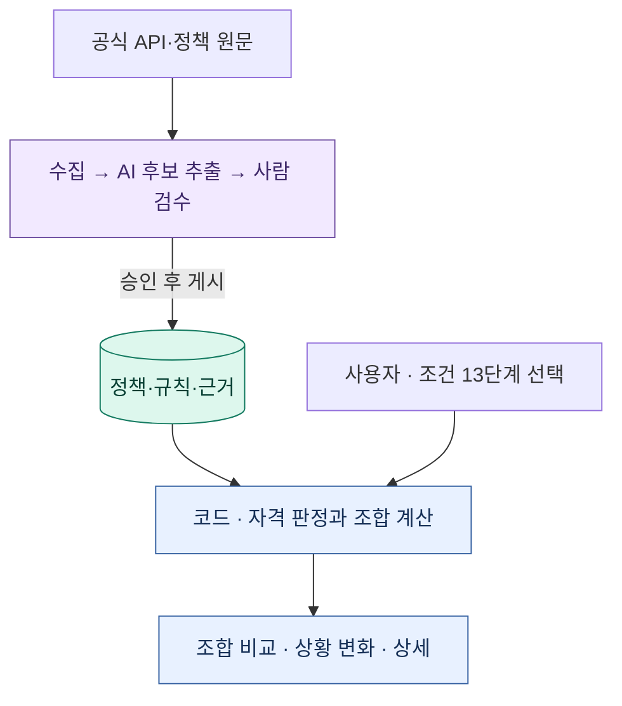
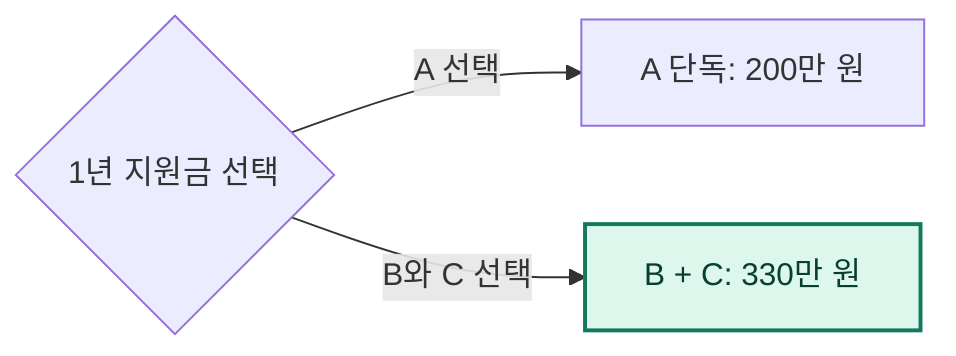

# AI 혜택 코치 (BenefitFinder AI)

**내 조건에서 함께 받을 수 있는 청년 지원금을 묶고, 조합별 총액과 선택 이유를 비교하는 서비스**를 만든다. 화면 이름은 ‘청년 정책 매니저’이며, 첫 MVP는 만 19~39세 청년의 **취업·주거 혜택**에 집중한다.

> 코디세이 AI 네이티브 Final Project · 5인 팀

[프로젝트 흐름](#프로젝트-흐름-한눈에-보기) · [로컬 실행](#로컬-실행) · [팀 역할](#팀원-역할과-기여) · [결과](#결과) · [평가자 안내](#평가자-안내) · [문서 지도](docs/README.md)

## 프로젝트 흐름 한눈에 보기



- **정책 준비:** 공식 자료에서 AI가 규칙 후보와 근거를 찾고, 사람이 검수한 정책·규칙·근거만 게시한다. [데이터 준비 흐름](docs/architecture/POLICY_DATA_PIPELINE.md)
- **사용자 요청:** 코드는 13단계 선택값과 정책을 비교해 자격·중복 제한·총액을 계산한다. 사용자는 조합과 상황 변화를 비교하고, 상세에서 근거와 공식 신청 안내를 확인한다. AI 설명은 선택 사항이다. [화면 흐름](docs/product/REQUIREMENTS.md#41-화면-목록과-흐름)

**지금 체험할 수 있는 범위:** 기본 로컬 실행은 공식 지역 목록과 가상 정책을 사용한다. 실제 정책의 검수·운영 게시와 제출 성과는 [현재 개발 상태](#현재-개발-상태)와 [결과](#결과)에서 구분한다.

단계별 문서는 [Markdown 문서 지도](docs/README.md)에서 찾을 수 있다. [HTML 문서 지도](docs/document-map.html)는 공고 세 건이 추천 조합으로 이어지는 예시를 장면별로 보여 준다. 파일을 내려받아 브라우저에서 열면 되고, 각 문서 링크는 GitHub로 연결된다.

## 해결하려는 문제

취업을 준비하거나 주거비를 줄이려는 청년은 여러 지원정책을 찾더라도 **그중 무엇을 함께 받아야 가장 이득인지** 다시 판단해야 한다. 정책마다 나이·소득·거주·가구 조건이 다르고, 다른 지원금과 함께 받을 수 없는 조건이나 예외도 있기 때문이다.

| 사용자가 막히는 질문 | 직접 비교해야 하는 내용 |
|---|---|
| 내 조건으로 받을 수 있나? | 공고별 자격 조건과 내 정보, 아직 확인하지 못한 조건 |
| 이 지원금들을 같이 받아도 되나? | 정책 사이의 중복 수급 제한·기간·예외 |
| 어떤 조합이 더 이득인가? | 함께 받을 수 있는 조합별 총액, 받는 기간과 시점 |
| 취업하거나 소득이 오르면 무엇이 달라지나? | 끊기거나 새로 받을 수 있는 지원금과 총액 변화 |

이 비교를 혼자 하다 보면 함께 받을 수 없는 지원금을 합산해 기대하거나, 개별 금액만 보고 더 유리한 조합을 놓칠 수 있다. 이 프로젝트는 **혜택을 찾은 뒤의 선택과 비교 부담**을 줄이는 데 초점을 둔다.

## 왜 조합을 비교해야 할까?

아래는 원리를 설명하기 위한 **가상 예시**다. 실제 정책·지급액이나 기능 명세의 정답 자료가 아니다. 사용자가 세 지원금의 자격을 모두 충족하고, 같은 1년 동안 받을 금액과 중복 조건이 모두 확인됐다고 가정한다. 여기서는 현재가치 할인을 적용하지 않은 지원액을 비교한다.

| 가상 지원금 | 1년 지원액 | 함께 받을 수 없는 지원금 |
|---|---|---|
| A | 200만 원 | B, C |
| B | 180만 원 | A |
| C | 150만 원 | A |



개별 금액은 A가 가장 크지만, B와 C를 함께 받으면 **1년 총액이 130만 원 더 커진다.**

[HTML 조합 실험실](docs/benefit-combination-lab.html)에서 A·B·C를 직접 골라 보세요. 파일을 내려받아 브라우저에서 열면 서버 없이 동작합니다.

## 목표하는 사용 경험

1. **내 조건 입력:** 주거지·소득·연령 등을 13단계 선택지로 고른다.
2. **자격과 조합 비교:** 조건별 진단과 함께 추천 조합·대안의 총액, 중복 제한 때문에 포기하는 지원금과 근거를 확인한다. 기간과 현재가치를 바꿔 비교할 수 있다.
3. **상황 변화 확인:** 취업·독립·소득 변화에 따라 어떤 지원금과 총액이 달라지는지 비교한다.
4. **신청 준비:** 확인할 조건·공식 공고·신청 방법으로 이어진다.

확인된 금액·조건을 기준으로 비교하고, 불명확한 자격·중복 조건은 ‘확인 필요’로 표시한다. 실제 수급 가능 여부는 신청 기관의 확인을 거친다.

이를 위해 공식 API에서 충분히 확인되지 않는 제한·예외는 공고·지침·FAQ를 데이터 Agent로 분석·정제하고 사람이 검수하는 흐름을 설계한다. 사용자 요청의 자격 판정·금액·조합 순위는 게시된 규칙과 코드가 계산한다. 상세한 문제 정의는 [기획서](docs/product/PROJECT_PLAN.md#1-문제-정의), 기능·계산 기준은 [기능 명세 v3.0](docs/product/REQUIREMENTS.md)을 따른다.

선택 입력 13단계와 F01~F14를 취업·주거에 적용하며, 생활·자산형성·교육·장학과 다른 대상의 혜택은 확장 단계에서 추가한다.

## 현재 개발 상태

| 영역 | 지금 확인할 수 있는 것 | 별도 검증·후속 |
| --- | --- | --- |
| 웹과 API | 공식 지역 선택 → 13단계 입력 → 가상 정책의 조합·상황 변화(S4)·상세(S5)·서비스(S6). 입력·결과 탭 복원, 조건 기억하기·삭제, PNG 저장. 가상 결과는 화면과 이미지에 표시 | 실제 서비스 정책·환산 단가 자료의 검수·게시 |
| 정책 계산·설명 | `POLICY_DATABASE_URL` 설정 시 [게시 현금 정책 카탈로그](backend/src/benefitfinder/infrastructure/database/POLICY_CATALOG.md)로 계산. F13은 [게시 조항과 선택적 로컬 모델](backend/src/benefitfinder/api/README.md#f13-설명-실행) 사용. [게시 서비스 카탈로그](backend/src/benefitfinder/infrastructure/database/SERVICE_CATALOG.md)의 환산액은 현금 조합과 분리 | 실제 정책 검수·운영 게시와 정책 사실 검증 |
| 수집·검수 도구 | [F08 정책·금리 통합 갱신](backend/src/benefitfinder/jobs/DAILY_REFRESH.md), [수집 성공본 DB 인계](backend/src/benefitfinder/infrastructure/database/COLLECTED_POLICIES.md), [F12 문서 분석 큐](backend/src/benefitfinder/infrastructure/database/F12_ANALYSIS.md)와 [확인된 API·공식 HTML/PDF의 입력 자동 준비](backend/src/benefitfinder/infrastructure/database/F12_PREPARATION.md) | 실제 대상 확대와 사람 검수·게시, 운영 스케줄·알림 도착 확인 |

F11 이용 통계는 명세의 17개 이벤트를 기존 백엔드를 통해 GA4로 전달하도록 연결했다. 사용자 조건·URL 원문은 제외하고 통계용 쿠키·브라우저 저장소 없이 임시 식별자를 사용한다. 기본 설정은 꺼짐이며, 실제 조장 계정 수신과 팀원 보기 권한은 [통계 설정 안내](backend/src/benefitfinder/infrastructure/ANALYTICS.md)에 따라 별도 확인한다.

실행 모드와 검증 범위는 [문서 지도의 구현 상태](docs/README.md#구현-상태)를 확인한다.

## 평가자 안내

이 절은 제출 준비 양식이다. 배포 주소·운영 실행 기록·실사용자 결과가 비어 있으면 검증 완료로 보지 않는다. 목표 기능과 현재 구현은 [현재 개발 상태](#현재-개발-상태)와 [문서 지도](docs/README.md#구현-상태)에서 구분한다. 클릭 시안의 S4·S5·S6은 실제 앱 구현과 별개다.

| 항목 | 내용 |
| --- | --- |
| 배포 URL | (배포 후 기입) |
| 접속 방법 | 로그인·회원가입 없이 위 주소로 바로 접속한다. 평가 전용 계정은 필요 없다 |
| 서비스 유지 | 결과 안내를 받을 때까지 유지한다 |
| 시연 영상 (3분 이내) | (촬영 후 링크 기입) |
| 기획서 | [docs/product/PROJECT_PLAN.md](docs/product/PROJECT_PLAN.md) |
| 기능 요구 명세서 | [docs/product/REQUIREMENTS.md](docs/product/REQUIREMENTS.md) (12장 시스템 아키텍처, 13장 AI 활용 명세, 14장 구현 현황 표) |
| 사용자 피드백 기록 | [docs/product/USER_TEST.md](docs/product/USER_TEST.md) 5장·6장 |
| 발표 자료 | (완성 후 `docs/` PDF 링크 기입) |
| 프로젝트 진행 기록 | (기입: 회의록·결정 기록 위치) |

### 평가자 테스트 방법

기능별 확인 방법과 기대 결과는 [구현 현황 표](docs/product/REQUIREMENTS.md#14-구현-현황-표)에 있다. 표에서 말하는 '테스트 조건 A'는 아래 값이다.

<details>
<summary>테스트 조건 A · 가상 인물의 13단계 선택값</summary>

| 단계 | 고를 값 |
| --- | --- |
| 1 나이 | 25 |
| 2 지역 | 경기도 · 수원시 |
| 3 지금 상황 | 취업 준비 |
| 4 최종 학력 | 대학 졸업 |
| 5 결혼 | 미혼 |
| 6 사는 형태 | 혼자 살아요 · 없어요 (무주택) · 세대주 |
| 7 집 계약 | 월세 · 보증금 5천만 원 이하 · 월세 40만 ~ 60만 원 |
| 8 소득과 재산 | 없음 · 1억 2천만 원 이하 |
| 9 해당 조건 | 해당 없음 |
| 10 관심 분야 | 취업, 주거 |
| 11 이미 받은 정책 | 없음 |
| 12 부모님 정보 | [건너뛰기] |
| 13 조건 확인 | 앞의 선택값 확인 후 [내 조합 찾기] |

</details>

**자동 갱신 확인** (F08, 목표 03:00 KST): [정책·금리 통합 실행·스케줄 안내](backend/src/benefitfinder/jobs/DAILY_REFRESH.md)를 따른다. 현재 CI는 매일 수집하는 스케줄러가 아니다. 실제 API 수집 성공·디스코드 도착·운영 스케줄 등록은 후속 검증이며, 해당 환경에서 확인한 요약·기록 위치를 제출 전에 기입한다.

**AI Agent 실행 기록 확인** (F12): [추출·검수·평가 CLI](backend/src/benefitfinder/jobs/README.md)를 따른다. 공유 가상 회귀와 실제 E4B 검증 요약은 관련 PR에 남기며, 실제 공고·검수·결과·로그는 로컬 `data/`에만 둔다. 제출용으로는 원문/개인정보를 제거한 실행 순서와 성공·실패 요약을 따로 확인한다.

### AI 사용 표시

- 서비스 목표: 생성된 설명에는 [AI] 표시와 근거를 붙이고, 기본 문구는 AI 생성으로 표시하지 않는다. 현재 앱은 결과 화면의 정책별 설명/근거와 이용 안내·개인정보 페이지를 제공하며 상세·서비스 화면은 서버의 가상 정책으로 연결했다. 클릭 시안의 설명은 가상 예시다.
- 개발: AI 도구(Claude, Codex 등)를 사용한 커밋·PR은 [협업 절차](CONTRIBUTING.md#ai-사용-표시)에 따라 PR 본문과 커밋 트레일러에 표시했다.

## 팀원 역할과 기여

각 팀원이 **본인이 직접** 기여 요약을 쓰고, 대표 커밋·PR·문서 링크를 붙인다. 기능별 담당은 [기능 명세 9장](docs/product/REQUIREMENTS.md#9-팀원별-담당-기능-및-협업-기준)을 따른다.

| 이름 | 역할 | 기여 요약 (본인 작성) | 대표 커밋·PR·문서 |
| --- | --- | --- | --- |
| 양승현 (조장) | 통합·배포 / 백엔드 | 백엔드 아키텍처 의존성 오류 해결, LLM 제공자 연동 및 F08 Windows 호환성 개선, Vercel·Render 배포 연동 설정, 통합 테스트 오류 수정 및 PR 병합 관리 | [PR #12](https://github.com/x17545/benefitfinder-ai/pull/12), [PR #21](https://github.com/x17545/benefitfinder-ai/pull/21), [PR #56](https://github.com/x17545/benefitfinder-ai/pull/56), [커밋 a6f70c9](https://github.com/x17545/benefitfinder-ai/commit/a6f70c9) |
| 이현서 | 기획 / 화면 설계 | | |
| 김하정 | 디자인 / 프론트엔드 | | |
| 윤정찬 | 원천 데이터 수집·적재 | 온통청년 청년정책 API 수집·원본 보관·버전 비교 구현, 공고 HTML·PDF 텍스트 변환(notice-text-v1) 추가, 실제 수집본 비교로 키워드 순서 변경에 따른 재검수 오탐을 찾아 수정(취업·주거 해시 변경 296→8건), 수집·적재·DB PR(#39~#49) 직접 실행 리뷰, ECOS 기준금리·온통청년 3,957건·보조금24 82건 실제 수집→PostgreSQL 적재 검증, 보조금24 10,942건 조사로 취업·주거 분류값과 수집 대상 매핑 정리 | [PR #8](https://github.com/x17545/benefitfinder-ai/pull/8), [PR #33](https://github.com/x17545/benefitfinder-ai/pull/33), [PR #52](https://github.com/x17545/benefitfinder-ai/pull/52), [PR #53](https://github.com/x17545/benefitfinder-ai/pull/53), [수집 문서](backend/src/benefitfinder/ingestion/README.md) |
| 탁서윤 | 데이터 정제·AI / 자동화 | | |

## 기술 스택

선정 이유는 [기획서 5.2](docs/product/PROJECT_PLAN.md#52-기술-스택과-선정-이유)에 있다.

| 영역 | 기술 |
| --- | --- |
| 화면 | React, TypeScript, Vite |
| 서버 | Python 3.12, FastAPI, Pydantic |
| DB | PostgreSQL. F13 게시 조항·검수 정책 카탈로그 조회와 계산 연결 구현. 실제 정책 게시·벡터/임베딩 검색은 후속 |
| AI | [로컬 llama.cpp](docs/development/LOCAL_LLM.md)로 추출·설명 검증. 실패 시 기본 문구로 복귀. Ollama는 호환 경로이며 운영 모델·예산은 확정 전 |
| 자동화 | F08 정책·금리 통합 실행·재시도·웹훅과 03:00 KST Linux systemd/macOS launchd 설정 생성. 운영 등록·실제 API/알림 도착은 후속 |
| 데이터 | 온통청년 수집·ECOS 기준금리 수동 갱신/DB 조회 구현. 보조금24 선택 ID의 API·DB·F12 연결 구현. 실제 매핑·운영 갱신은 후속 |
| 개발 도구 | uv, pnpm, GitHub Actions CI |
| 배포 | Vercel/Render 실행 설정 있음. 운영 API·배포 주소의 전체 흐름 검증은 별도 |

## 로컬 실행

Node.js 24, pnpm 11.25.0, uv 0.9.5 이상을 준비하고 저장소 루트에서 실행한다. Python 3.12와 루트 `.venv`는 uv가 관리한다. 처음 설치하거나 실행이 안 되면 [처음 개발 시작하기](docs/development/GETTING_STARTED.md)를 따른다.

```sh
uv sync --locked
pnpm install --frozen-lockfile
pnpm dev
```

- 웹: [http://127.0.0.1:5173](http://127.0.0.1:5173)
- API 문서: [http://127.0.0.1:8000/docs](http://127.0.0.1:8000/docs)
- 생존 확인: [http://127.0.0.1:8000/health](http://127.0.0.1:8000/health)

DB·LLM 키 없이 실행한다. `pip`·`npm`·`npx` 대신 uv·pnpm을 사용하고, 의존성 선언과 lockfile을 함께 관리한다.

## 결과

기본 로컬 환경에서는 **공식 지역 선택 → 13단계 조건 입력 → 가상 조합 결과 → 상황 변화·상세·서비스 확인**을 시험할 수 있다. 검수한 규칙과 설명 근거를 같은 버전으로 게시하는 경로는 가상 자료로 검증했다. 실제 원문의 분석 결과는 검수 대기이며 운영 정책 게시와는 구분한다. [검증과 운영 현황](docs/README.md#구현-상태)

다음 제출 결과는 확인한 뒤 기입한다.

- 구현 결과: [구현 현황 표](docs/product/REQUIREMENTS.md#14-구현-현황-표) 기준 Must 기능 (기입)개 중 (기입)개 동작
- 사용자 테스트: 실사용자 (기입)명, 주요 지표와 개선 내용은 [사용자 테스트 결과](docs/product/USER_TEST.md#6-피드백과-반영-기록-제출용)
- 대표 화면: (기입: 결과 화면·S6 캡처)

## 개발 시작점

| 하고 싶은 일 | 먼저 볼 문서 |
|---|---|
| 어떤 제품인지 이해하기 | [기획서](docs/product/PROJECT_PLAN.md), [기능 명세](docs/product/REQUIREMENTS.md), [기획 개요·일정·제출물](docs/product/OVERVIEW.md) |
| 작업을 나누고 PR 올리기 | [협업·개발 절차](CONTRIBUTING.md), [Git 작업 절차](docs/development/GIT_WORKFLOW.md) |
| 구현 위치 정하기 | [아키텍처](docs/architecture/ARCHITECTURE.md), [웹 구조](apps/web/README.md), [백엔드 구조](backend/README.md) |
| API·데이터 연결하기 | [공용 계약](contracts/README.md), [정책 데이터 준비](docs/architecture/POLICY_DATA_PIPELINE.md) |
| 코딩 에이전트로 작업하기 | [공용 지침](AGENTS.md), 수정 경로의 하위 `AGENTS.md` |

역할과 기능별 인계의 기준은 [기능 명세 9장](docs/product/REQUIREMENTS.md#9-팀원별-담당-기능-및-협업-기준)이다. 팀원별 장기 브랜치 대신 기능별 짧은 브랜치와 PR을 사용한다. `main` 직접 작업·푸시와 `codex/` 접두어는 금지한다.

## 저장소 구조

```text
apps/web/       React + TypeScript + Vite
backend/        FastAPI, 공통 판정·분야별 규칙·데이터 준비 경계
contracts/      공용 JSON Schema와 가상 예제
docs/
  README.md     문서 지도와 구현 상태
  document-map.html  흐름별 문서 탐색 (브라우저)
  product/      기획 개요·기능 명세·사용자 테스트
  architecture/ 기술 설계·정책 데이터 준비
  development/  설치·컨벤션·Git·저장소 운영
  prototype/    화면 참고 HTML·PNG
  archive/      과거 기록 (현행 수락 기준 아님)
scripts/        공통 검사와 계약 타입 생성
tests/          계약·기획용 참조 계산 검증
```

## 검증

```sh
uv run --locked python scripts/check.py
```

PR 전에는 작업 브랜치에 최신 `origin/main`을 머지하고 충돌을 해결한다. 검토할 변경을 커밋한 뒤 `uv run --locked python scripts/check.py --pr`을 실행한다. 이 검사는 웹 빌드와 실제 HTTP 오류 계약을 포함하지만, 미구현 정책 기능이나 실제 PostgreSQL·LLM·정책 사실의 검증을 뜻하지 않는다. 상세 범위와 한계는 [저장소 운영 안내](docs/development/REPOSITORY_SETTINGS.md#3-현재-공통-검사의-범위)를 따른다.
