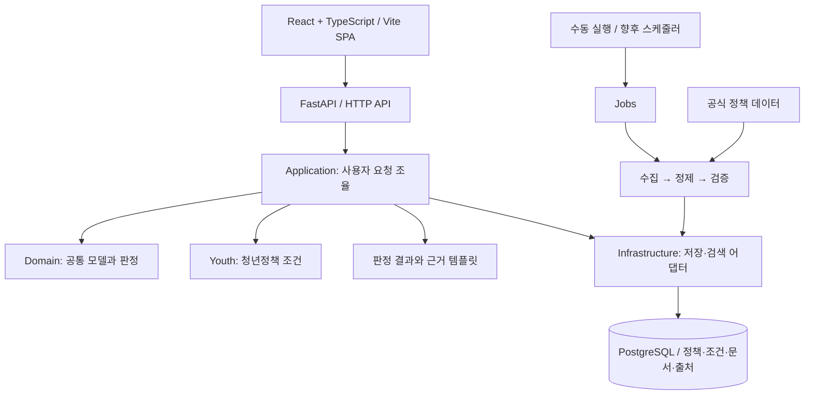

# 아키텍처 설계

설계 갱신일: 2026-10-28. **React + TypeScript + Vite, Python + FastAPI, PostgreSQL**을 확정했다. 기능·화면은 [기획 명세 v2](../REQUIREMENTS_v2.md)를 따른다. 이 문서는 그 기획을 구현할 위치와 경계를 정하며, 실행 프로젝트 초기화와 제품 기능 구현은 아직 완료하지 않았다. 기술 결정의 원본은 9장이다.

## 1. 설계 기준

- 초기 MVP는 청년 대상 취업·주거 혜택이며 기획 명세 v2의 F01~F11을 이 두 분야에 적용한다. 선택지 13단계, 조합·현재가치·상황 변화, 기억하기·이미지 저장·통계·자동 갱신을 포함한다. 생활·자산형성·교육·장학 등은 이후 확장한다(2026-10-27 추가 회의).
- 공통 혜택 처리와 분야별 조건을 분리해 다른 분야를 추가할 수 있게 한다.
- 5명이 각자의 디렉터리에서 작업하고, 공용 계약과 예제로 먼저 연결한다.
- 초기 운영은 모듈형 모놀리스로 구성한다. 기능별 서비스 배포, 메시지 브로커, 플러그인 프레임워크는 실제 필요가 생길 때 검토한다.
- 구조화된 정책 DB 조회·조건 비교·금액 계산과 근거 템플릿을 MVP 기본으로 한다. RAG·Agent·LLM·임베딩은 필요성이 확인될 때 검토하며 필수 의존성이나 완료 조건으로 두지 않는다.

## 2. 구성과 실행 흐름

위 화살표는 실행 흐름이며 Python import 방향과는 구분한다. 일반 애플리케이션 코드가 검색·판정·계산의 순서와 분기를 실행하며 실제 진행 상태를 SSE로 전송한다. 구조화된 조건으로 검색하고 원문 인용은 저장된 근거에서 조회한다.

프론트엔드는 Vite로 빌드하는 React SPA이며 Next.js 서버나 SSR을 전제하지 않는다. 브라우저는 FastAPI의 HTTP API로만 데이터에 접근하고, DB 연결·LLM 호출·비밀 키는 백엔드가 관리한다. 프론트엔드와 백엔드를 논리적으로 나누되 실제 배포 단위와 호스팅은 아직 정하지 않는다.

개발 환경에서는 Vite의 `/api/v1`·`/health` 프록시를 FastAPI에 연결하는 방식을 기본으로 한다. 운영에서는 같은 출처의 `/api/v1`을 백엔드로 보내는 구성을 우선 검토한다. 서로 다른 출처가 필요하면 백엔드 CORS 허용 목록을 실제 프론트엔드 주소로 제한한다. 현재 프록시·CORS·배포 설정은 아직 없다.

수집·분석·정제 단계에서 정책의 조건·금액·중복 제한과 원문 근거를 구조화하고 사람이 검수한다. 사용자 요청에서는 선택값으로 DB 후보를 찾고 순수 판정·계산 코드를 실행한다. 추천 이유와 신청 안내는 검수된 근거·결과를 템플릿으로 정리한다. 원문 처리에 AI 보조가 필요해져도 온라인 분석에 Agent나 벡터 DB를 함께 도입할 필요는 없다.

데이터 갱신은 같은 백엔드 패키지의 별도 실행 진입점으로 분리한다. 양승현은 실행·스케줄·재시도·실패 알림을, 윤정찬은 원천 수집·출처 관리를, 탁서윤은 수집 데이터 분석·정제·품질 검증을 담당하며 김하정은 API·DB 연동을 지원한다. 매일 03:00 KST 갱신은 기획 요구이고 스케줄러 제품은 아직 정하지 않았다.

## 3. 디렉터리와 책임

| 경로 | 책임 | 주 담당 |
|---|---|---|
| `apps/web/src/app/` | React 앱 조립, 라우팅, providers, 전역 스타일 | 프론트엔드 |
| `apps/web/src/features/` | 혜택 결과·사용자 조건 등 사용자 기능 | 프론트엔드 |
| `apps/web/src/shared/` | 공통 UI, API 클라이언트, 공개 설정, 공용 타입 | 프론트엔드 |
| `apps/web/src/domains/youth/` | 청년정책 전용 표시·입력 설정 | 프론트엔드 |
| `backend/src/benefitfinder/api/v1/routers/` | FastAPI v1 엔드포인트, 사용 사례 호출 | 백엔드 |
| `backend/src/benefitfinder/api/schemas/` | 계약에 맞춘 Pydantic 요청·응답 모델 | 백엔드, 계약 공동 검토 |
| `backend/src/benefitfinder/api/dependencies/` | 조립된 사용 사례를 HTTP 요청에 연결 | 백엔드 |
| `backend/src/benefitfinder/application/` | 추천·상세 조회 등 사용 사례와 외부 기능 인터페이스 | 백엔드, 데이터 협의 |
| `backend/src/benefitfinder/domain/` | 공통 혜택·조건·근거 모델과 순수 판정 | 공동 검토 |
| `backend/src/benefitfinder/domains/youth/` | 청년정책 특유의 필드·조건 해석·규칙 | 데이터 분석·정제, 백엔드 협의 |
| `backend/src/benefitfinder/ai/` | 향후 AI 보조 기능을 검토할 기존 자리. 현재 MVP 의존성 없음 | 현재 전담 없음 |
| `backend/src/benefitfinder/ingestion/` | 원천 수집·출처 관리 / 수집 후 분석·정규화·품질 검증 | 윤정찬 / 탁서윤, 파일별 분담 |
| `backend/src/benefitfinder/infrastructure/` | DB, 검색, LLM·외부 API 클라이언트의 구체 구현 | 백엔드, 관련 담당 협의 |
| `backend/src/benefitfinder/infrastructure/database/` | PostgreSQL 연결·트랜잭션, DB 전용 모델과 저장소 구현 | 백엔드 |
| `backend/src/benefitfinder/jobs/` | 수집·갱신 실행·스케줄·재실행·실패 알림 | 양승현, 김하정 API·DB 협업 |
| `backend/migrations/versions/` | PostgreSQL 스키마 변경 이력 | 백엔드 |
| `contracts/` | API·수집 결과가 공유하는 교환 형식 | 공동 검토 |

`domain`은 프로그램의 공통 업무 개념을 뜻하고, `domains/youth`는 적용 분야를 뜻한다. 청년 여부를 확인하는 조건문을 공통 API·검색·UI 곳곳에 추가하지 않는다.

취업(`employment`)·주거(`housing`)는 `youth` 안의 정책 분류다. 활성 분류를 청년 모듈의 설정·검수 기준으로 관리하고 수집·검색·판정·조합·상황 변화·상세·입력 선택에 일관되게 적용한다. 다른 청년 분류를 추가할 때는 같은 모듈과 공용 모델을 확장한다. 공식 분류 매핑이나 복합 정책의 포함 여부가 불명확하면 검수로 확인하고, 이름에 취업·주거 단어가 있다는 이유만으로 범위에 넣지 않는다.

실제 하위 경로는 [프론트엔드 구조](../apps/web/README.md)와 [백엔드 구조](../backend/README.md)를 따른다. 현재는 빈 패키지·자리표시자와 안내 문서이며, `main.tsx`·`vite.config.ts`·FastAPI `main.py`·DB 연결 코드는 초기화할 때 추가한다.

## 4. 의존성 규칙

1. `domain/`은 Python 표준 라이브러리만 사용한다. 웹, DB, LLM SDK에 의존하지 않는다.
2. `domains/youth/`는 공통 `domain/`을 사용해 청년정책의 특수 조건을 정의한다. 다른 분야 모듈에 의존하지 않는다.
3. `application/`은 공통 `domain/`과 자기 모듈의 인터페이스로 흐름을 조율한다. 분야별 구체 구현·DB·LLM 클래스는 import하지 않고 조립 지점에서 주입받는다.
4. `ai/`, `ingestion/`, `infrastructure/`는 공통 모델과 `application/`의 인터페이스에 맞춰 구현한다. 서로의 내부 파일을 직접 호출하지 않는다.
5. `api/`는 사용 사례를 호출한다. FastAPI 라우터 안에 추천, 프롬프트, 수집 로직이나 SQL을 넣지 않는다. 요청 의존성 함수는 이미 조립된 객체를 꺼내 연결하고, 구체 DB·LLM 어댑터를 직접 import하거나 생성하지 않는다.
6. 구체 구현의 연결은 향후 `backend/src/benefitfinder/bootstrap.py`에서 수행한다. 이 파일과 실행 진입점만 조립을 위해 여러 구현 모듈을 참조한다.
7. `jobs/`는 수집 흐름을 실행한다. 출처별 파싱이나 데이터 정제 로직은 `ingestion/`에 둔다.

MVP의 검색·상세 조회·판정은 일반 application 사용 사례로 조율한다. 향후 선택 AI 기능을 도입하면 필요한 인터페이스만 주입한다. AI 모듈이 API 라우터나 애플리케이션 전체를 재호출하지 않게 해 순환 의존을 피한다. AI의 출력으로 판정 코드가 정한 결과를 덮어쓰지 않는다.

실제 인터페이스는 기능 구현 시 필요한 것부터 추가한다. 미리 대형 추상 클래스나 범용 규칙 언어를 만들지 않는다.

## 5. 공용 계약과 독립 개발

교환 데이터의 기준은 `contracts/v1/*.schema.json`이다. FastAPI 경계의 Pydantic 모델, 순수 업무 모델, PostgreSQL 저장 모델은 책임을 구분하며 외부에 내보내는 결과는 계약을 따른다. 초기화 시 JSON Schema에서 TypeScript 타입을 생성하는 경로와 실제 API 입출력·OpenAPI가 계약과 일치하는 검증을 추가한다. 생성 도구는 아직 정하지 않았다. 프론트엔드에서 같은 요청·응답 타입을 수기로 다시 정의하지 않는다.

| 계약 | 목적 |
|---|---|
| `benefit.schema.json` | 수집 결과를 공통 혜택 형식으로 정규화 |
| `profile.schema.json` | 사용자 조건과 분야별 추가 정보 |
| `recommendation-request.schema.json` | 추천 요청 |
| `recommendation-response.schema.json` | 조합·기간별 결과·조건별 근거·확인 필요 항목 |
| `error.schema.json` | 오류 코드와 사용자 메시지 |

- 프론트엔드는 가상 응답을 로딩해 화면을 만든다. 모의 응답 사용 여부가 실제 실행과 혼동되지 않게 한다.
- 데이터 담당은 가상 혜택과 같은 모양으로 수집 결과를 정규화한다.
- 데이터 수집·분석·정제 담당은 가상 혜택과 조건·근거를 맞추고 누락·중복·변경 사례를 검증한다. 양승현은 실행·재시도, 김하정은 API·진행 이벤트를 검증한다. 결과 화면의 추가 질문이나 챗봇은 만들지 않는다.
- 백엔드는 같은 데이터를 사용하는 임시 저장소로 통합할 수 있다. 실제 저장소 연결 전까지 예제를 실데이터로 안내하지 않는다.
- 계약 변경은 영향받는 담당자와 검토하고 스키마·예제·테스트를 함께 수정한다.

계약은 **형식**을 검증한다. 정책의 사실성, 출처의 공신력, 근거가 판정을 실제로 뒷받침하는지는 별도 데이터 품질·근거 검수로 검증한다.

## 6. 데이터 모델과 저장 경계

공통 혜택에는 `id`, `domain`, 제목, 운영 기관, 분류, 신청 정보, 자격 조건, 출처와 확인 시점을 둔다. `domain`은 `youth`에 고정된 열거형이 아닌 분야 식별 문자열이다. 혜택 ID는 `youth:source:external-id`처럼 충돌을 피할 수 있게 구성한다.

청년정책 특유의 값은 `domain_data`에 둔다. 확장 필드의 이름·단위·의미는 해당 분야 문서에서 정의하고, 실제 사용 전 분야별 검증을 추가한다. 다른 분야에서도 쓰이기 시작한 필드는 검토 후 공통 모델로 올린다.

기본 저장소는 PostgreSQL이며 구현은 `infrastructure/database/`에 둔다. ORM·드라이버와 실제 테이블·인덱스는 아직 정하지 않았다. 검색·필터링에 필요한 공통 조건은 조회 가능한 구조로 관리하고, 분야별 확장값을 저장하는 방식은 데이터 모델 구현 시 정한다. 아래 경계를 유지한다.

| 데이터 | 관리 원칙 |
|---|---|
| 원본 공고·수집 기록 | 정규화 결과와 분리하고 원문·수집 시점 보존 |
| 정규화 혜택·조건 | 공통 ID·분야·출처 버전으로 갱신 |
| 공고 문서·검색 청크 | 원문 문서 ID·버전을 연결해 판정 근거 추적 |
| 검색 인덱스 | 원문과 정규화 데이터로 재생성 가능하게 관리 |
| 사용자 조건 | 서버·로그에 저장하지 않음. 기억하기를 선택한 경우에만 브라우저에 30일 저장하고 사용자가 삭제 가능 |

공고가 바뀌면 문서 버전과 검색 인덱스도 함께 갱신한다. 재수집은 안정적인 원천 ID를 사용해 중복을 만들지 않도록 한다. 검증 실패 항목은 게시 대상과 분리하고, 소득·가구 정보가 없으면 확인 필요로 남긴다.

로컬 원본·정제 결과·인덱스는 `data/` 아래 생성하되 Git에 올리지 않는다. 공유 가상 데이터의 기준은 `contracts/fixtures/`다.

DB 스키마 변경은 `backend/migrations/versions/`에 이력으로 관리한다. 애플리케이션 import·서버 시작 시 자동 테이블 생성으로 마이그레이션을 대신하지 않는다. DB 연결 설정은 백엔드 환경 변수로만 전달하며 프론트엔드 `VITE_*`·번들·공개 파일에 넣지 않는다. PostgreSQL 연동은 별도 테스트 DB로 검증하고 실제 사용자·운영 DB를 테스트에 사용하지 않는다.

## 7. 예정 API 경계

아래는 기획 명세 v2를 기존 버전 경계에 맞춘 API 설계이며 아직 구현하지 않았다. 현재 개발용 필드·자료형과 이벤트 데이터의 원본은 `contracts/v1/`이다. 6장의 필드·형식과 11.2의 임시 기본값은 다음 회의에서 확인할 초안으로 유지한다.

| Method | 경로 | 용도 |
|---|---|---|
| GET | `/health` | 서버 동작 확인 |
| GET | `/api/v1/meta` | 마지막 갱신·기준금리·분석 이용량 정보 |
| GET | `/api/v1/options` | 지역 코드와 선택지·금액 구간 |
| POST | `/api/v1/recommendations` | 선택 조건으로 분석, SSE 진행·조합 결과 |
| POST | `/api/v1/simulations` | 같은 조건과 변경 시나리오의 전후 비교 |
| GET | `/api/v1/benefits/{benefit_id}` | 공통 혜택 상세 조회 |

지원 분야는 초기 `youth` 하나다. 계약이 다른 분야 식별자를 허용하더라도, 서버는 아직 지원하지 않는 분야에 `unsupported_domain` 오류를 반환해야 한다. 입력 오류는 `invalid_request`, 의존 서비스 장애는 `dependency_unavailable`처럼 구분한다. 상세 HTTP 상태는 `contracts/README.md`를 따른다.

분석은 JSON 본문의 선택 조건과 `Accept: text/event-stream`을 받는 POST로 설계한다. 브라우저는 `fetch` 응답 스트림을 읽고 UTF-8 SSE 메시지의 `progress`·최종 `result` 또는 `error`를 처리한다. native `EventSource`의 URL에 프로필을 넣지 않는다. 마지막 이벤트 한 번 후 종료하며 청크 경계와 이벤트 경계가 같다고 가정하지 않는다. 취소·최대 60초 타임아웃·재시도에 따른 사용량 처리는 서버 초기화 시 검증한다. [SSE 형식](https://developer.mozilla.org/en-US/docs/Web/API/Server-sent_events/Using_server-sent_events), [Fetch 응답 스트리밍](https://developer.mozilla.org/en-US/docs/Web/API/Fetch_API/Using_Fetch#streaming_the_response_body)을 참고한다.

상세 GET은 정책의 공개 정보만 반환한다. 서버에 프로필을 저장하지 않으므로 선택 후의 진단은 현재 분석 응답에서 연결하고, 조건 없는 직접 상세 접근에는 조건 입력 안내를 보여 준다. 사용자 조건을 URL·쿼리 문자열에 싣지 않는다.

로그·추적에는 요청 ID와 처리 상태를 기록하고, 사용자 조건·소득 정보·LLM 프롬프트 전체·API 키를 남기지 않는다. 특수 조건·부모님 정보는 LLM·임베딩·GA에도 전달하지 않는다. 기억하기를 끄면 프로필을 영구 저장하지 않으며, 결과 캐시와 프로필 저장·삭제 범위는 기획 명세와 공용 계약 안내를 따른다.

### 기능별 구현 책임

| 기획 기능 | 구현 위치 |
|---|---|
| F01 선택 입력, F09 기억하기, F10 이미지 저장 | 웹 `features/profile`, `features/benefits`, `domains/youth` |
| F02 정책 검색, F03 분석 흐름·진행 상태 | 백엔드 `application`, DB 조회·판정·계산 코드·근거 템플릿 |
| F04 자격, F05 조합·현재가치, F06 상황 변화 | `domain`의 순수 계산, `domains/youth` 정책 조건, `application` 조율 |
| F07 상세·신청 안내 | `application`·`api`, 저장소 인터페이스 |
| F08 갱신 | `jobs` 진입점, `ingestion` 정제, `infrastructure` 원천·DB·검색 어댑터 |
| F11 배포·통합·이용량·통계 | API 경계·외부 설정, 웹 이벤트. 배포 제품은 추후 선택 |

## 8. 다른 분야를 추가하는 순서

1. 대상·데이터 출처·자격 기준·용어를 정의하고 공통 모델로 표현 가능한지 확인한다.
2. `backend/src/benefitfinder/domains/<분야>/`에 고유 조건과 규칙을 추가한다.
3. `ingestion/`에 필요한 출처 어댑터·정규화 코드를 추가한다. 원본 필드를 API가 직접 읽게 하지 않는다.
4. 분야별 추가 데이터의 스키마와 가상 예제를 `contracts/`에 추가하고 검증한다.
5. 조립 지점에 지원 분야를 등록하고, 공통 API와 검색에서 해당 분야를 선택할 수 있게 한다.
6. 전용 입력·표시가 필요한 경우에만 `apps/web/src/domains/<분야>/`를 추가한다.
7. 공통 UI·조회·근거·판정 상태를 재사용하면서 해당 분야의 품질 사례를 검증한다.

두 번째 분야가 생기기 전에는 자동 탐색 플러그인·범용 규칙 엔진을 만들지 않는다. 현재는 공통 필드와 모듈 경계를 안정화한다.

## 9. 기술 선택과 검증 범위

### 확정한 결정

2026-10-27 사용자 합의로 아래 조합을 선택했다. 오래된 기획서의 스택 검토안보다 이 결정을 우선한다.

| 영역 | 선택 | 근거·경계 |
|---|---|---|
| 프론트엔드 | React + TypeScript + Vite | 입력·혜택 카드·근거 표시를 컴포넌트로 구성하는 SPA. TypeScript strict 사용 |
| 웹 패키지 관리 | npm + `package-lock.json` | 초기화 시 하나의 도구·lockfile로 통일 |
| 백엔드 | Python + FastAPI | Python이 익숙한 팀의 백엔드·AI·수집 코드를 공유하고 명시적인 HTTP 경계로 연결 |
| API 검증 | Pydantic | FastAPI의 요청·응답 모델에 사용. 순수 domain 모델에는 프레임워크 의존성 없음 |
| 기본 DB | PostgreSQL | 정책·조건·출처·버전 데이터를 관리. 프론트엔드가 직접 접속하지 않음 |
| 실행 구조 | 모듈형 모놀리스 | 하나의 백엔드 코드베이스와 별도 수집 명령. 분야 확장은 공통 모델과 분야별 모듈로 처리 |

기능·화면은 기획 명세 v2가 기준이다. 수집 API의 승인·호출 가능 범위와 실제 검수 완료 정책 수는 실행 시 확인한다. 사용자 로그인·서버 저장은 도입하지 않는다.

### 아직 정하지 않은 것

- ORM·PostgreSQL 드라이버·마이그레이션 도구, 런타임 세부 버전·의존성 관리 도구
- 선택 AI 기능의 필요성·범위. 도입할 경우에만 LLM·RAG·Agent·벡터 검색 도구 검토
- 스케줄러·작업 큐, 배포 서비스·운영 구성

pgvector는 PostgreSQL에서 의미 검색이 필요해질 때 검토하는 선택 사항이다. 처음부터 별도 벡터 DB·Redis·분산 작업 큐를 요구하지 않는다. 미정 도구의 선택은 공통 분야 모델을 바꾸지 않게 어댑터에 둔다.

### 구현·검증 상태

- 스택 결정과 실제 패키지 초기화를 구분한다. 현재 React·Vite 프로젝트 설정, FastAPI 실행 진입점, DB 연결·마이그레이션 설정과 제품 기능은 아직 없다.
- 현재 `python scripts/check.py`는 Git 작업 상태·파일 형식·직접 import 경계와 JSON Schema·가상 예제·잘못된 입력·확장 분야의 회귀 검증을 수행한다. PR 준비 검사는 `--pr`로 실행하며 자세한 범위는 [저장소 운영 설정](REPOSITORY_SETTINGS.md)을 따른다.
- 웹 초기화 시 lint·typecheck·build와 CI의 `npm ci`를 연결하고, FastAPI 초기화 시 HTTP 입력·오류·계약 검증을 추가한다. PostgreSQL 저장소를 구현하면 테스트 DB에서 마이그레이션·읽기·쓰기를 검증한다.
- 기능 구현 후에는 판정·설명·원문 근거 일치 검증, 수집·정제 데이터 품질 검사, 필요한 웹 통합 테스트를 각 영역에 추가한다. 현재 공통 검사 통과가 이 검증들을 대신하지 않는다.

설계 참고: [FastAPI의 모듈 분리 안내](https://fastapi.tiangolo.com/tutorial/bigger-applications/), [Vite 환경 변수와 공개 범위](https://vite.dev/guide/env-and-mode), [JSON Schema 조합](https://json-schema.org/understanding-json-schema/reference/combining), [jsonschema 검증 문서](https://python-jsonschema.readthedocs.io/en/stable/validate/).
