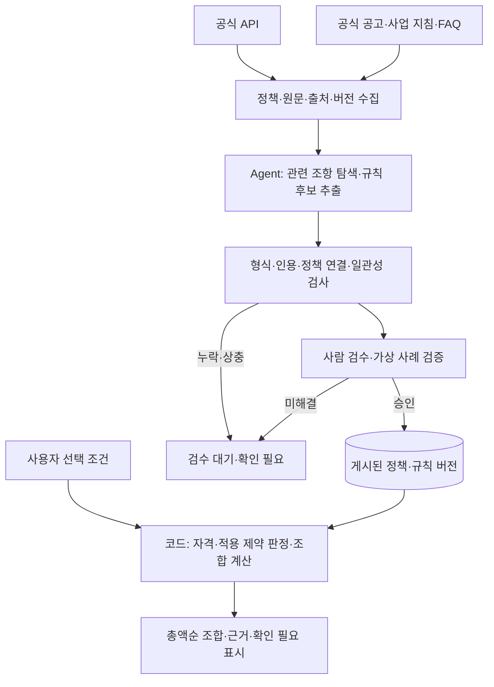

# 정책 데이터 분석·정제와 Agent 활용

2026-10-28 사용자의 역할 변경 취지와 제품 설명을 반영한 설계 작업본이다. 현재 수집·Agent·검수·계산 기능은 구현되지 않았다. 기능·계산 규칙은 [요구 명세](../REQUIREMENTS_v2.md), 모듈 경계는 [아키텍처](ARCHITECTURE.md), 교환 형식은 [공용 계약](../contracts/README.md)을 따른다.

## 1. 핵심 과제

제품은 사용자의 주거지·소득·연령 등을 받아 함께 받을 수 있는 지원금 조합을 총액순으로 비교한다. 개별 지원금의 자격뿐 아니라 정책 사이의 중복 수급 제한·예외를 알아야 조합과 순위에 의미가 있다.

원천 API에 이 조건들이 충분히 구조화되어 있는지는 실제 응답으로 확인해야 한다. API 응답만으로 확인되지 않는 내용은 해당 정책의 공식 공고·사업 지침·FAQ·연결된 공식 문서를 분석해 보완한다. API에 제한 정보가 없다는 사실은 중복 수급 허용의 근거가 아니다.

탁서윤은 이 단계의 데이터 분석·정제에 AI Agent를 활용하는 작업을 맡는다. AI 업무를 없애는 역할 변경이 아니다. 특정 모델·Agent 프레임워크·RAG·벡터 DB 채택은 아직 확정하지 않았다.

## 2. 데이터 준비와 사용자 요청

Agent는 허용된 공식 자료 조회, 연결 문서 확인, 조항 추출, 누락 검사와 재추출을 수행하도록 설계한다. 관련 문서를 찾아 해석하는 과정에 RAG를 사용할 수 있지만 특정 검색 방식은 미정이다. 원문 분석은 갱신 작업에서 수행하고, 사용자 요청마다 웹 탐색과 모델 해석을 반복하는 흐름을 기본으로 삼지 않는다.

게시된 규칙이 있으면 사용자 검색·계산은 LLM 없이 동작한다. 데이터 Agent에 사용자 프로필을 보낼 필요가 없으며, 입력은 공개 정책 문서와 정책 식별 정보로 제한한다. 추천 이유는 코드 결과와 검수한 근거의 템플릿을 기본으로 한다.

## 3. 규칙 후보에 남길 정보

아래는 분석·검수 산출물의 논리적 항목이며 새 API 필드나 확정 DB 스키마가 아니다. 최종 이름·자료형과 지원 범위는 관련 담당자가 계약 설계 때 정한다.

| 항목 | 확인할 내용 |
|---|---|
| 적용 정책 | 제한을 명시한 정책, 대상 정책·사업군과 별칭. 연결 대상이 불명확하면 확정하지 않음 |
| 제한 내용 | 동시 수급 불가, 수급 이력 제한, 조건부 허용, 금액 차감·상한 등 원문이 실제로 명시한 관계 |
| 방향·시점 | A 수급 이력이 B 신청을 제한하는지, 같은 지급 기간에만 적용되는지, 기준일·유효 기간 |
| 조건·예외 | 소득·거주·대상자 조건, 예외 사업·대상·기간과 필요한 입력값 |
| 금액 영향 | 제외인지 차감인지, 적용 금액·상한·단위·지급 시점. 확인되지 않은 값은 미상 |
| 근거 | 실제 인용문, 공식 URL, 문서 버전·수집 시점, 페이지·절 등 위치 |
| 검수 상태 | 추출 초안·검사 결과·검수자·검수 시점·미해결 사유·게시 버전 |

단순한 `A ↔ B` 금지 쌍은 무조건적인 동시 수급 금지에만 사용한다. 수급 순서·기간·조건·예외가 있는 규칙을 영구적인 양방향 금지로 축약하지 않는다. 금액 차감·상한도 전체 배제로 바꾸지 않는다. 현재 `conflicts` 계약은 단순 금지 쌍만 표현하므로 복잡한 규칙의 표현·평가 범위는 다음 회의의 계약 검토 항목이다. 실행 코드로 지원하지 못하는 조건은 원문·미해결 사유와 함께 검수 대기로 남기며, 지원한 것으로 표시하지 않는다.

## 4. 검수·게시 기준

- Agent의 출력은 규칙 후보이며 곧바로 운영 규칙이나 최종 자격 판정이 되지 않는다. 형식 검사만으로 의미가 검증됐다고 보지 않는다.
- 인용이 해당 버전 원문에 존재하는지와 인용이 규칙·예외·금액을 뒷받침하는지를 확인한다. API 설명과 공고가 상충하면 임의로 한쪽을 선택하지 않고 검수로 넘긴다.
- 한 공고의 규칙이 다른 정책에 적용되는지 정책 ID·사업군·기간을 확인한다. LLM 신뢰 점수나 문서에 제한이 안 보인다는 이유만으로 허용·금지 상태를 확정하지 않는다.
- 확인되지 않은 관계는 `needs_review`로 유지한다. 기존 F05의 확인 필요 조합 표시를 따르되, 해당 순위가 확인된 금액·제약에 따른 참고 결과임을 표시하며 확정 동시 수급을 보장하지 않는다.
- 검수된 정책·규칙·근거의 같은 게시 버전으로 계산한다. 원문이 바뀌면 그 원문에 의존하는 규칙도 검수를 해제하고 재분석한다. 실패한 재수집·추출로 마지막 성공 데이터나 확인 시각을 덮어쓰지 않는다.
- 계산은 지원되는 검수 규칙을 코드로 평가한다. Agent가 직접 금액을 합산하거나 조합 순위·코드 판정을 덮어쓰지 않는다.

## 5. 담당자와 모듈 경계

| 담당자 | 책임·인계 |
|---|---|
| 윤정찬 | 공식 API·원문 수집, 출처·정책 ID·버전·변경 내역 → 탁서윤 |
| 탁서윤 | Agent의 원문 분석·규칙 후보 추출·평가, 정규화·검수 자료 → 김하정. 데이터 정제는 윤정찬과 파일별 분담 |
| 김하정 | 검수 규칙의 저장·조회와 코드 판정·조합 계산, 지원하지 못하는 규칙의 명시적 처리 |
| 양승현 | 수집·분석·갱신 실행, 스케줄·재시도·비용 한도·실패 및 재검수 알림 |
| 이현서 | 확인 필요·비교 근거·포기하는 지원금의 화면과 표현 검토 |

`ai/`는 추출 전략·도구 조율·평가, `ingestion/`은 파싱·정규화·검수·게시 흐름, `infrastructure/`는 공식 자료·LLM·DB 클라이언트, `jobs/`는 실행을 담당한다. 기존 인터페이스와 조립 지점을 통해 연결하고 모듈 사이의 직접 import 금지 규칙을 유지한다. 새 서버나 대형 범용 규칙 엔진은 추가하지 않는다.

## 6. 구현 시 평가와 다음 회의 항목

공식 문서에서 사람이 검수한 규칙과 가상 사용자·조합 정답을 묶어 추출과 계산을 각각 평가한다. 필수 사례는 단순 충돌, 조건부 예외, 과거 수급·기간 제한, 금액 차감·상한, 사업 별칭, 근거 누락·상충, 원문 변경이다. 추출이 정확해도 누락된 제한이 없는지 별도로 확인한다. 공유 예제는 가상값으로 만들고 실제 수집 자료는 Git 제외 경로에 둔다.

다음 회의에서는 실제 API·원문 표본으로 부족한 정보를 확인하고, MVP가 코드로 지원할 복잡한 규칙의 범위·계약, 검수 담당·게시 기준, Agent 모델·도구·정확성·호출 비용·재시도 한도를 정한다. 정책 관계를 정리하는 작업과 사용자 조합 계산의 정답 검증을 함께 계획한다. 이는 기획자 승인이나 구현 완료를 대신하지 않는다.
