# AI 혜택 코치 (BenefitFinder AI)
## 기능 요구 명세서 v2.5 (화면 설계 · 데이터 형식 · 디자인 가이드 포함)

- 프로젝트: 코디세이 Final Project
- 팀 구성: 5명
- 작성일: 2026-10-26
- 작성: 이현서 (기획·프론트엔드)
- 제출 마감일: 2026-11-25
- 문서 상태: v2.5 (2026-10-28 사용자 요청으로 uv·pnpm 개발 도구와 실행 초기화 반영. 2026-10-28 사용자 설명에 따라 데이터 Agent의 원문 분석·중복 제한 추출 역할 반영. 팀 공유본. 첫 MVP는 만 19~39세 청년의 취업·주거 혜택만 다룬다. 생활/자산형성/교육·장학은 확장으로 미룬다. F01~F11·13단계·기존 스택 유지. 사용자 검색·계산은 검수된 규칙과 코드, 설명은 근거 템플릿 기본. 기술·계약 정렬은 개발용 초안으로 다음 회의 확인 필요)
- 기반 문서: 프로젝트 기획서 v1.1, 요구명세 v1.0. 원문은 [기획서 아카이브](../archive/PROJECT_PLAN_v1.1_ARCHIVE.md)와 [요구명세 아카이브](../archive/REQUIREMENTS_v1_ARCHIVE.md)에 보존했고, 현재 진입 문서는 v2 기준으로 갱신했다. v2.1 기획 시나리오(가상 정책 5개·정답 8개) 원문은 [기획 시나리오 아카이브](../archive/PLANNING_SCENARIOS_v2.1_ARCHIVE.md)에 보존했고 현행 수락 조건이 아니다
- 계약 정렬 상태: `contracts/v1`은 현재 개발 기준 SSOT이며, 6장·11.2는 다음 회의 확정 대상 초안이다. 데이터 Agent의 모델·도구·평가 기준과 복잡한 중복 규칙의 표현·코드 지원 범위도 검토한다. RAG·임베딩·벡터 DB는 미확정이다. 계약 정렬을 기획자가 최종 승인한 것으로 쓰지 않는다
- 문서 안내: [문서 지도](../README.md), [기획 개요·일정·제출물](OVERVIEW.md). 이 파일은 현행 기능 명세이며 버전은 본문에서 관리한다. 목표 수락 조건과 [현재 구현 상태](../README.md#구현-상태)를 구분한다
- 클릭되는 화면 시안: [docs/prototype/index.html](../prototype/index.html) (내려받아 브라우저로 열기)
- 화면 표시 이름: 청년 정책 매니저 (프로젝트 이름은 AI 혜택 코치 그대로)

※ 이 기획 문서는 Claude(AI)와 작성했고, 결정은 작성자가 했다.

---

## 0. v1.0에서 바뀐 점

| 구분 | v1.0 | v2.0 |
| --- | --- | --- |
| 핵심 가치 | 관련 정책 3 ~ 5개 함께 추천 | **함께 받을 수 있는 지원금 조합 중 총액이 가장 큰 조합**을 계산해 추천 |
| 입력 | 자연어 문장 입력 + AI 조건 추출 (M01, M02) | **선택지 13단계** (F01). 문장 입력·챗봇 없음 |
| 우선순위 | Must / Should / Could | 구분 없음. **이 문서의 기능은 모두 구현**한다 |
| 중복 수혜·총액·혜택 절벽 | Should·Could | 핵심 기능 F05·F06으로 구현 |
| 추가 기능 | | 매일 자동 갱신(F08), 기억하기(F09), 결과 이미지 저장(F10), 현재가치·포기하는 지원금·실효한계세율 |
| 대상 나이 | 만 19 ~ 34세 | **만 19 ~ 39세** |
| 분석 처리 (과거 Agent 도구로 제안) | 조회·판정 중심 | 조합·상황 변화 계산 추가. 현행은 일반 백엔드 함수로 실행(2.1·F03) |
| 문서 | 요구 명세만 | 요구 명세 + 화면 설계 + 데이터 형식·API + 디자인 가이드를 **이 문서 하나로** |
| 데이터 | 공식 청년정책 데이터 | 온통청년 청년정책 API + 공공데이터포털 공공서비스(보조금24) API + 한국은행 기준금리 |

기능 ID 대응: M01·M02 → F01 / M03 → F02 / M04 → F03 / M05 → F04 / M06 → F05 / M07 → F07 / M08 → F11

### 이 문서를 읽는 법

| 사람 | 먼저 읽을 곳 |
| --- | --- |
| 조장 | 2 ~ 3장, 5장 F08·F11, 6.5 API, 7장, 9장, 11장 |
| 이현서 | 전부 |
| 김하정 (백엔드) | 5장 F04 ~ F07, 6장, 8.3 테스트 사용자, 4장 S3·S4·S5 화면 |
| 탁서윤 (수집 데이터 분석·정제) | 5장 F02·F04·F05·F08의 데이터 기준, 6.1·6.2, 7.2 개인정보, 8.3 정답 자료, 9장 인계 |
| 윤정찬 (정책데이터) | 5장 F04·F05·F08, 6.1·6.2 데이터 형식, 8.3 테스트 사용자, 4.3 단계별 질문 |

### 쉬운 말 풀이

| 말 | 뜻 |
| --- | --- |
| 조합 | 동시에 받을 수 있는 지원금 묶음. 예: 월세 지원 + 적금 + 구직 지원금 |
| 중복 수혜 제한 | "다른 사업과 함께 받을 수 없음" 같은 조건. 이것 때문에 조합을 계산해야 한다 |
| 현재가치 | 나중에 받는 돈을 지금 돈으로 바꾸면 얼마인지. 3년 뒤 120만 원은 지금 120만 원보다 가치가 작다 |
| 포기하는 지원금 (기회비용) | 이 조합을 고르면 함께 못 받아서 놓치는 지원금 |
| 실효한계세율 | 소득이 오를 때 끊기는 지원금 때문에 실제로 사라지는 비율. "더 번 돈 100원 중 몇 원이 사라지나" |
| 혜택 절벽 | 소득이 기준선을 살짝 넘었을 뿐인데 지원금이 크게 끊겨서 오히려 손해가 되는 지점 |
| 기준 중위소득 | 정부가 해마다 발표하는 '가운데 소득'. 정책 소득 기준이 "중위소득 ○○% 이하"처럼 나온다 |
| RAG | 정책 원문을 검색해서 AI 답에 근거로 붙이는 방식 |
| AI Agent | AI가 필요한 도구를 골라 작업을 수행하는 방식. 현행 계획에서는 공식 문서 탐색·조항 추출·누락 검사 등 데이터 분석·정제에 활용 |
| SSE | 서버가 진행 상황을 화면에 실시간으로 계속 보내 주는 방식 |

## 1. 문서 목적

본 문서는 AI 혜택 코치(청년 정책 매니저)의 기능과
구현 범위, 기능별 처리 규칙과 완료 기준을 정의한다.

팀원별 개발 방향을 일치시키고,
기능 통합 및 최종 평가를 위한 기준으로 활용한다.

기존 서비스(온통청년, 보조금24, 토스 등)는 **어떤 정책이 있는지** 알려 준다.
이 서비스는 **어떤 지원금 조합을 받는 게 가장 이득인지** 계산해 준다.

## 2. 서비스 핵심 흐름

1. 시작 화면에서 이용 안내 확인, 필수 동의
2. 선택지로 조건 입력 (13단계)
3. 백엔드가 검색·판정·계산을 순서와 분기 조건에 따라 실행 (진행 단계를 화면에 실시간 표시)
4. 구조화된 정책 DB 검색 → 조건별 자격 진단 → 함께 받을 수 있는 조합 계산
5. 최대 조합 3개(추천 1 + 대안 2)를 총액과 함께 비교, 포기하는 지원금 표시
6. 조합 속 지원금마다 자격 진단, 추천 이유, [신청하러 가기]
7. 상황이 바뀌면(취업, 소득 상승 등) 조합·총액 변화와 실효한계세율 확인
8. 정책 상세에서 원문 근거, 신청 방법, 공식 출처 확인

### 2.1 사용자 기능과 구현 방식의 구분

제품의 핵심은 사용자 조건에 맞고 서로 양립할 수 있는 지원금 조합을 총액순으로 비교하는 것이다. 13단계 선택값과 검수된 정책·중복 제한을 비교하는 사용자 요청은 일반 백엔드 함수와 DB 조회로 처리한다. 검색·자격 진단·최적 조합·상황 변화 및 결과 없음·확인 필요·실패 분기는 애플리케이션 코드가 결정하며, SSE 진행 전송도 온라인 Agent의 도구 선택을 전제하지 않는다.

이 계산에 필요한 복잡한 중복 수급 제한·예외가 원천 API만으로 확보되는지는 실제 응답으로 확인한다. 부족한 정보는 공식 공고·사업 지침·FAQ를 보완 수집하고 **데이터 Agent로 원문을 분석해 규칙 후보를 추출 → 검증·사람 검수 → 버전별 게시**하는 방향으로 설계한다. 탁서윤의 데이터 분석·정제 이동은 이 AI 업무에 집중한다는 뜻이다. API에 제한이 없다는 이유로 동시 수급 허용을 추정하지 않는다.

추출한 규칙은 적용 정책·방향·기간·조건·예외·금액 영향·원문 근거를 보존하며, 미지원·불명확·상충은 검수 대기와 확인 필요로 남긴다. 추천 이유와 '지금 할 일'은 검수된 근거와 코드 결과의 템플릿으로 작성한다. Agent 모델·도구·평가 기준은 비교 후 정하고 RAG·임베딩·벡터 DB를 자동으로 필수화하지 않는다. 상세와 인계 기준은 [정책 데이터 분석·정제 설계](../architecture/POLICY_DATA_PIPELINE.md)를 따른다. 이 설계는 아직 구현되지 않았으며 기획자 승인을 대신하지 않는다.

### 2.2 데이터 출처

데이터 출처: 온통청년 청년정책 API(주), 공공데이터포털 공공서비스(보조금24) API(보완), 한국은행 ECOS 기준금리(현재가치 할인율). 전국의 청년 취업·주거 정책을 수집하고, 금액·중복 제한·지급 시점을 사람이 검수한 정책만 조합 계산에 넣는다. 두 분야 안에서 30개 검수를 목표로 하며 실제 확보 수는 아직 검증하지 않았다. 생활·자산형성·교육·장학 등 나머지 분류는 확장에서 다룬다.

| 층 | 대상 | 쓰이는 곳 |
| --- | --- | --- |
| 전체 수집 | 연령 조건이 19 ~ 39세와 겹치는 전국 취업·주거 정책 (자동 수집) | 검색, 자격 진단, 정책 상세 |
| 검수 완료 | 금액·중복 제한·지급 시점을 사람이 확인한 취업·주거 정책 (30개 검수 목표는 취업·주거 안에서 유지하되 확보 검증 아님) | 조합 계산, 상황 변화 계산 |

## 3. 기능 목록과 개발 범위

### 3.1 기능 목록

여기 있는 F01~F11을 모두 취업·주거 혜택에 적용한다. 13단계 입력은 유지한다. 정책 분류 범위를 좁힌 결정이며 기능을 후속 단계로 미룬 결정은 아니다.

| ID | 기능명 | 주요 내용 | 주 담당 | 화면 |
|---|---|---|---|---|
| F01 | 조건 선택 입력 | 13단계 선택지로 조건 입력, 확인·수정 | 이현서 | S2 |
| F02 | 정책 검색 | 구조화된 정책 DB에서 후보와 연결된 근거 조회 | 김하정 (데이터: 윤정찬·탁서윤) | L, S3 |
| F03 | 분석 흐름·진행 상태 | 검색·판정·계산 조율, 진행 이벤트 전송 | 김하정 | L |
| F04 | 자격 진단 | 조건별 충족·미충족·확인 필요 판정 | 김하정 | S3, S5 |
| F05 | 최적 조합 | 중복 제한 반영, 총액 기준 상위 조합 최대 3개, 포기하는 지원금, 현재가치 | 김하정 | S3 |
| F06 | 상황 변화 분석 | 조건이 바뀔 때 조합·총액 변화, 실효한계세율, 혜택 절벽 | 김하정 | S4 |
| F07 | 정책 상세·신청 안내 | 원문 근거, 신청 기간·방법·서류, 공식 링크 | 김하정 | S5 |
| F08 | 매일 자동 갱신 | 매일 새벽 3시 정책·기준금리 갱신, 디스코드 보고 | 양승현 (수집·정제: 윤정찬·탁서윤) | 없음 |
| F09 | 이 기기에 기억하기 | 조건을 브라우저에 30일 저장, 지우기 | 이현서 | S1, S2, 공통 |
| F10 | 결과 이미지 저장 | 조합 비교 결과를 그림으로 저장 | 이현서 | S3 |
| F11 | 배포·통합 | 배포, 하루 사용 상한, 이용 통계 | 조장 | 전체 |

### 3.2 개발 범위 원칙

- 자격 판정·금액·조합·현재가치·실효한계세율은 코드로 계산한다. 설명은 검수된 근거와 템플릿을 기본으로 하며 계산 결과를 바꾸지 않는다
- F02는 정책 검색, F03는 분석 흐름·진행 상태로 구현한다. 데이터 준비에는 Agent 원문 분석·규칙 추출을 계획하며, 사용자 요청의 코드 계산과 분리한다. 구체 모델·도구와 RAG·임베딩은 미확정이다
- 서비스는 실제 신청 자격을 확정하지 않는다
- 입력되지 않은 정보는 임의로 추정하지 않는다. 미입력은 충족으로 처리하지 않는다
- 추천과 진단에는 확인 가능한 근거(공고 원문, 출처, 확인일)를 표시한다
- 대상은 만 19 ~ 39세 청년 개인이다. 기업·소상공인 정책은 다루지 않는다
- 초기 수집·검색·진단·조합·상황 변화·상세·관심 선택은 모두 청년 취업·주거로 한정한다. 취업(`employment`)·주거(`housing`)는 `domain: youth` 안의 분류이며 별도 앱·서버·최상위 domain으로 나누지 않는다
- 원천 API 분류를 검수해 대응시키고, 복합·불명확 정책은 포함 여부를 사람이 확인한다. 이름에 취업·주거 단어가 있다는 이유만으로 포함하지 않는다
- 금액·중복 제한·지급 시점을 사람이 검수한 정책만 조합에 넣는다. 두 분야 안에서 30개 검수를 목표로 하되 실제 확보 수는 아직 검증하지 않았다

### 3.3 만들지 않는 것

- 초기 MVP의 생활·자산형성·교육·장학 등 취업·주거 외 혜택 (확장 단계에서 추가)

- 문장 입력, 챗봇 대화, 결과 화면 추가 질문
- 로그인, 회원가입, 서버에 사용자 정보 저장
- 마감·변경 알림
- 화면 안 피드백 기능 (사용자 테스트 설문은 따로)
- 결과 링크 공유 (이미지 저장만)
- 정책 자동 신청, 최종 수급 자격 확정
- 두 API에 없는 정책 (크롤링·지자체 홈페이지 안 씀)
- 기업·소상공인 대상 정책
- 정책 내용을 고치는 관리자 화면 (검수는 검수 표 → 스크립트로 DB 반영)
- PC 전용 레이아웃 (PC에서도 모바일 폭으로 보여 줌)
- 세금·4대 보험 계산 (실효한계세율은 지원금 변화만 본다)

---

## 4. 화면 설계

> 기존 PNG 11개는 범위 축소 전 화면 기록으로 보존한다. 그림 속 생활·자산형성·교육·장학 선택지·과거 금액·AI 표시·Agent 도구 문구는 현행 기준이 아니다. 현재 문구·규칙과 클릭 시안(`docs/prototype/index.html`)은 취업·주거 기준이다.

> 지금 그림은 HTML 시안 기준이다. **화면 구조, 요소, 동작, 문구는 확정**이고, 색·모양·크기는 10장 디자인 가이드(피그마 확정본)를 따른다.
> 그림의 빨간 번호 = 아래 표의 번호. 정책 이름과 금액은 모두 가상의 값이다.

### 4.1 화면 목록과 흐름

```
S1 시작 ─▶ S2 조건 선택 (1 ~ 13단계) ─▶ L 로딩 ─▶ S3 내 지원금 조합 ─▶ S5 정책 상세 ─▶ (외부) 신청 페이지
                                                       │
                                                       └─▶ S4 상황이 바뀌면?
```

| ID | 화면 | 주소 | 들어오는 길 |
| --- | --- | --- | --- |
| S1 | 시작 | `/` | 첫 접속, 로고, 404의 [처음으로] |
| S2-n | 조건 선택 n단계 | `/conditions/{1-13}` | S1 [시작하기], S3 [조건 수정] → 13단계 |
| L | 로딩 | `/loading` | S2-13 [내 조합 찾기] |
| S3 | 내 지원금 조합 | `/result` | L 완료 |
| S3-E | 결과 없음 | `/result` (결과 0개일 때) | L 완료 |
| S4 | 상황이 바뀌면? | `/what-if` | S3 버튼 |
| S5 | 정책 상세 | `/policy/{정책ID}` | S3 지원금 행, 주소 직접 입력 |
| P1 | 이용 안내 | `/about` | 하단 메뉴, S1 [자세히] |
| P2 | 개인정보 처리방침 | `/privacy` | 하단 메뉴, S1 동의 문구 |
| P3 | 없는 페이지 | 그 외 | |

화면 공통

- 모바일 먼저. PC에서는 **가운데에 폭 최대 480px**로 보여 주고 바깥은 배경색으로 채운다
- 모든 화면은 주소가 있어 브라우저 뒤로 가기가 된다. 화면이 바뀌면 맨 위로 스크롤
- 상단 바: [‹ 뒤로] + 화면 제목 + 오른쪽 보조 버튼(화면마다 다름). S1과 L에는 뒤로가 없다
- 하단 고정 버튼: 화면 아래에 붙어 있는 큰 버튼 하나. 조건을 다 고르기 전에는 비활성
- 하단 메뉴 (S1, S3, S4, S5, 공통 페이지): 이용 안내 · 개인정보 처리방침 · 내 정보 지우기 + "데이터 출처 온통청년 · 보조금24 · 매일 새벽 3시 갱신"

### 4.2 S1 시작

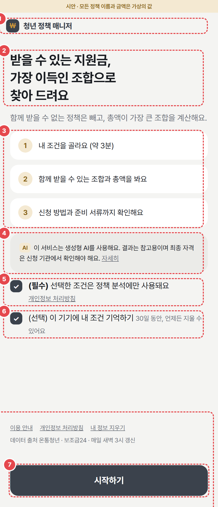

| 번호 | 요소 | 내용·동작 |
| --- | --- | --- |
| 1 | 서비스 이름 | 로고 + '청년 정책 매니저'. 누르면 S1 |
| 2 | 한 줄 소개 | 문구 S1-01. 아래 설명 문구 S1-02 |
| 3 | 사용 순서 3단계 | 문구 S1-03 ~ 05. 누르는 동작 없음. 걸리는 시간은 사용자 테스트에서 재고 고친다 |
| 4 | 서비스 안내 | 조건 비교·계산 결과의 참고 성격과 최종 자격 확인 안내. [자세히] → P1 |
| 5 | 필수 동의 체크 | 체크해야 7번이 켜진다. [개인정보 처리방침] → P2 (체크는 바뀌지 않음) |
| 6 | 기억하기 체크 (선택) | 켜면 조건을 이 기기에 30일 저장 (F09) |
| 7 | [시작하기] | 5번 체크 전 비활성. 누르면 S2-1 |
| 8 | 하단 메뉴 | 공통 |
| 그림 없음 | 지난 조건 카드 | 저장된 조건이 있으면 2번 위에 표시. "만 25세 · 경기도 수원시 · 취업 준비 · 혼자 살아요" 요약 + [이 조건으로 다시 보기] → L + [내 정보 지우기] |

### 4.3 S2 조건 선택

공통 구성: 상단 바(뒤로, 'n / 13') + 진행 막대 + 질문 하나 + 선택지 + 하단 [다음]

- 필수 항목을 다 골라야 [다음]이 켜진다
- [‹ 뒤로]는 이전 단계. 고른 값은 유지된다
- 13단계(확인)에서 항목을 누르면 그 단계로 가고, 거기서 [다음]을 계속 누르면 다시 13단계로 온다
- 하나만 고르는 질문은 큰 목록(선택지), 짧은 값은 작은 칩, 여러 개 고르는 질문은 칩 + '해당 없음'(고르면 나머지 해제)

#### 단계별 질문

| 단계 | 질문 (문구 ID) | 입력 | 선택지 | 필수 |
| --- | --- | --- | --- | --- |
| 1 | 나이가 어떻게 되나요? (S2-1) | 숫자 입력 | 만 나이. 35세 이상이면 아래에 '군 복무를 마쳤나요?' 칩: 해당 없음 / 1년 6개월 이하 / 1년 6개월 초과 ~ 2년 / 2년 초과 | 필수 |
| 2 | 어디에 살아요? (S2-2) | 드롭다운 2개 | 시·도 17개 → 시·군·구. 하위 단위가 하나면(세종) 자동 선택 | 필수 |
| 3 | 지금 상황은요? (S2-3) | 하나 | 고등학생 / 대학생 (휴학 포함) / 대학원생 / 취업 준비 / 재직 (정규·계약) / 단기·일용 근로 / 자영업 / 프리랜서 / (예비) 창업 / 농업·어업 / 기타 | 필수 |
| 4 | 최종 학력은요? (S2-4) | 하나 | 고졸 미만 / 고등학교 재학 / 고등학교 졸업 / 대학 재학·휴학 / 대학 졸업 예정 / 대학 졸업 / 석·박사 | 필수 |
| 5 | 결혼했나요? (S2-5) | 하나 | 미혼 / 기혼 / 결혼 예정 (3개월 안) | 필수 |
| 6 | 어떻게 살고 있어요? (S2-6) | 하나 + 칩 2줄 | 사는 형태: 혼자 / 부모님과 함께 / 배우자·가족과 / 기숙사·고시원 / 기타 · 집 소유: 없어요 (무주택) / 있어요 / 모름 · 세대주: 세대주 / 세대원 / 모름 | 3개 모두 |
| 7 | 지금 사는 집 계약은요? (S2-7) | 하나 + 칩 | 월세 / 전세 / 자가 / 계약 없음. 월세·전세면 보증금: 5천만 원 이하 / 5천만 ~ 1억 / 1억 ~ 3억 / 3억 초과. 월세면 월세: 40만 원 이하 / 40만 ~ 60만 / 60만 ~ 70만 / 70만 초과 | 보이는 것 모두 |
| 8 | 본인 소득과 재산은요? (S2-8) | 칩 2줄 | 연 소득(세전): 없음 / 1,500만 미만 / 1,500만 ~ 3,000만 / 3,000만 ~ 5,000만 / 5,000만 이상 / 모름 · 재산: 1억 2천만 이하 / 1억 2천만 ~ 3억 4,500만 / 3억 4,500만 초과 / 모름 | 둘 다 (모름 가능) |
| 9 | 해당하는 게 있나요? (S2-9) | 여러 개 | 기초생활수급자 / 차상위계층 / 한부모가정 / 장애인 / 중소기업 재직 / 농업인·어업인 / 군 복무 중 / 해당 없음 | 1개 이상 |
| 10 | 어떤 지원에 관심 있어요? (S2-10) | 여러 개 | 취업 / 주거 (초기에는 두 선택지만 제공. 나머지 분류는 확장 단계) | 1개 이상 |
| 11 | 이미 받고 있거나 받았던 게 있나요? (S2-11) | 여러 개 | 청년월세 지원 / 청년도약계좌·청년미래적금 / 청년내일저축계좌 / 국민취업지원제도 / 버팀목 전세대출 / 없음 | 1개 이상 |
| 12 | 더 정확하게 볼까요? (S2-12) | 칩 3줄 | 가구원 수: 1명 / 2명 / 3명 / 4명 이상 / 모름 · 부모님 집 한 달 소득(세전, 가구 전체): 300만 이하 / 300만 ~ 500만 / 500만 ~ 700만 / 700만 초과 / 모름 · 부모님 재산: 3억 이하 / 3억 ~ 5억 / 5억 초과 / 모름 | 선택. 상단 [건너뛰기]. **기혼이면 질문 대신 안내만** |
| 13 | 이 조건으로 찾을까요? (S2-13) | 요약 | 고른 값 전부. 건너뛴 값은 '건너뜀' | |

11단계의 과거 자산형성 수혜 이력은 취업·주거 정책의 중복·가입 제한 확인에 필요한 경우에만 사용한다. 해당 분류의 정책을 추천한다는 뜻은 아니다.

구간 경계는 실제 정책 기준선에서 왔다 (예: 재산 1억 2천만 원 = 청년월세 청년가구 재산 기준, 3억 4,500만 원 = 버팀목 순자산 기준). 데이터를 보고 정찬·하정이 바꿀 수 있고, 바꾸면 이 표를 고친다.

#### 대표 화면

**S2-1 나이 (만 41세를 넣은 경우)**

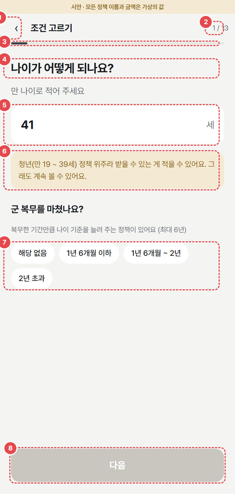

| 번호 | 요소 | 내용·동작 |
| --- | --- | --- |
| 1 | [‹ 뒤로] | 이전 화면 |
| 2 | 단계 표시 | 'n / 13' |
| 3 | 진행 막대 | n ÷ 13 만큼 채움 |
| 4 | 질문 | 문구 S2-1 |
| 5 | 나이 입력칸 | 숫자만 입력 (다른 글자는 지워짐). 숫자 키패드. 오른쪽에 '세' |
| 6 | 나이 안내 | 19 미만이나 39 초과일 때만. 문구 S2-1-N. 막지 않고 계속 진행 가능 |
| 7 | 군 복무 칩 | 35세 이상일 때만 나타남. 나타나면 필수 |
| 8 | [다음] | 나이 입력(35세 이상은 군 복무도) 전 비활성 |

**S2-6 사는 형태**

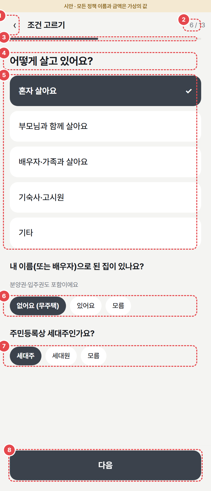

| 번호 | 요소 | 내용·동작 |
| --- | --- | --- |
| 1 ~ 4 | 공통 | 뒤로, 단계, 진행 막대, 질문 |
| 5 | 사는 형태 선택지 | 하나. 고르면 ✓ 표시와 진한 배경 |
| 6 | 집 소유 칩 | 하나. 보조 문구 "분양권·입주권도 포함이에요" |
| 7 | 세대주 칩 | 하나 |
| 8 | [다음] | 5 ~ 7 모두 고르기 전 비활성 |

**S2-9 해당 조건 (여러 개 고르기)**

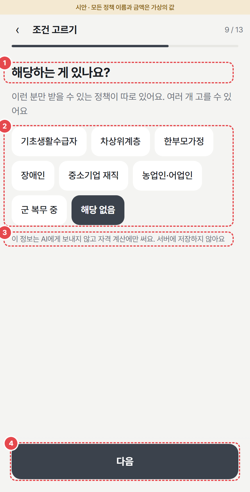

| 번호 | 요소 | 내용·동작 |
| --- | --- | --- |
| 1 | 질문 | 문구 S2-9 |
| 2 | 여러 개 칩 | 여러 개 선택. '해당 없음'을 누르면 나머지 해제, 다른 칩을 누르면 '해당 없음' 해제 |
| 3 | 민감 정보 안내 | 문구 S2-9-P (7.2 개인정보 보호) |
| 4 | [다음] | 1개 이상 고르기 전 비활성 |

**S2-12 더 정확하게 (선택 단계)**

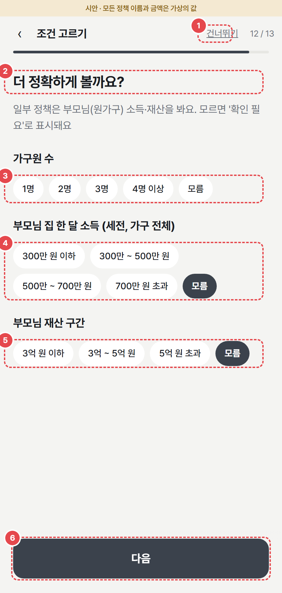

| 번호 | 요소 | 내용·동작 |
| --- | --- | --- |
| 1 | [건너뛰기] | 상단 바 오른쪽. 누르면 S2-13. 이 단계 값은 비워 둔다 |
| 2 | 질문 | 문구 S2-12. 만 30세 이상이면 문구 S2-12-30 덧붙임 |
| 3 ~ 5 | 가구원 수, 부모님 소득, 부모님 재산 | 각각 하나. 안 골라도 [다음] 가능 |
| 6 | [다음] | 항상 켜짐 |
| 그림 없음 | 기혼일 때 | 3 ~ 5 대신 문구 S2-12-M만 보여 주고 [건너뛰기] 없음 |

**S2-13 확인**

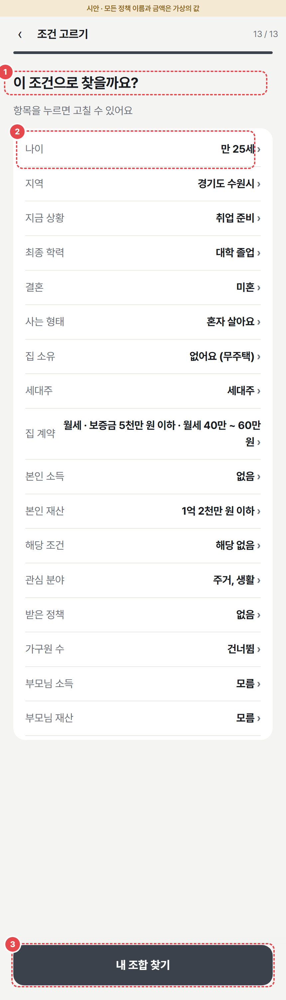

| 번호 | 요소 | 내용·동작 |
| --- | --- | --- |
| 1 | 질문 | 문구 S2-13 |
| 2 | 요약 행 | 왼쪽 항목 이름, 오른쪽 고른 값 + ›. 누르면 그 단계로. 기혼이면 부모님 행 3개 숨김 |
| 3 | [내 조합 찾기] | L로 이동하며 분석 시작 |

### 4.4 L 로딩

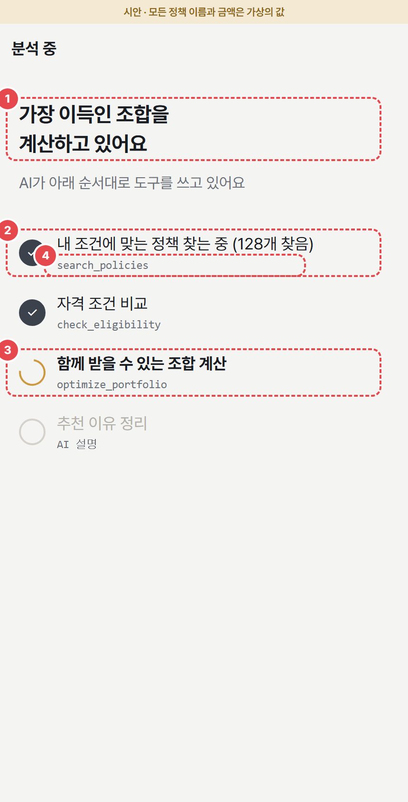

| 번호 | 요소 | 내용·동작 |
| --- | --- | --- |
| 1 | 제목 | 문구 L-01, L-02 |
| 2 | 끝난 단계 | ✓ + 단계 이름 + 결과 숫자(있으면, 예: 128개 찾음) |
| 3 | 진행 중 단계 | 도는 표시 + 굵은 글씨 |
| 4 | 처리 단계 | 사용자가 이해할 진행 문구를 표시한다. 내부 함수명이나 Agent 호출 표시는 필요하지 않다 |

- 단계 줄은 서버가 SSE로 보내는 진행 이벤트를 받을 때마다 하나씩 추가·체크한다 (6.5). 미리 정해진 애니메이션이 아니다
- 결과 이벤트를 받으면 S3로 간다. 결과가 0개면 S3-E
- **15초 안 완료가 목표. 60초가 넘으면 실패**로 보고 실패 화면
- 실패 화면: 문구 L-E1 + [다시 시도] (같은 조건으로 재요청) + [조건 수정] → S2-13. 고른 조건은 유지
- 하루 상한 초과: 문구 L-E2 + [처음으로]
- 로딩 중 뒤로 가기: 요청을 취소하고 S2-13

### 4.5 S3 내 지원금 조합

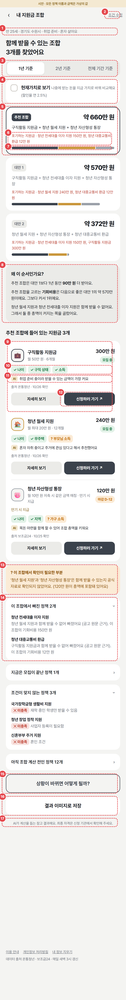

| 번호 | 요소 | 내용·동작 |
| --- | --- | --- |
| 1 | 조건 요약 | "만 25세 · 경기도 수원시 · 취업 준비 · 혼자 살아요". 그 아래 제목 문구 S3-01 |
| 2 | [조건 수정] | 상단 바 오른쪽. S2-13으로 |
| 3 | 기간 탭 | 1년 기준 / 2년 기준 / 전체 기간 기준. 바꾸면 총액·순위를 다시 계산하고 추천 조합을 선택 상태로 |
| 4 | 현재가치로 보기 | 체크. **처음엔 꺼짐.** 켜면 모든 금액을 현재가치로 바꾸고 순위를 다시 매김. 할인율 표시 "할인율 연 ○.○%" |
| 5 | 조합 카드 (최대 3개) | 배지(추천 조합 / 대안 1 / 대안 2) + 총액 + 구성("A + B + C"). 누르면 선택(테두리) → 아래 9번 목록이 그 조합으로 바뀜 |
| 6 | 포기하는 지원금 | 이 조합 때문에 함께 못 받는 지원금 이름과 금액. 없으면 줄 없음 |
| 7 | 금액 비율 막대 | 조합 안 정책별 금액 비율. 막대 전체 길이 = 1위 총액 대비 비율 |
| 8 | 왜 이 순서인가요? | 문구 S3-W1 ~ W4. 숫자는 코드가 채움 |
| 9 | 지원금 행 | 아이콘 + 정책 이름 + 금액 요약 + 기간 금액 + 모집 상태 태그. 행을 누르면 S5. 현재가치를 켜면 금액 아래 원래 금액에 취소선 |
| 10 | 진단 칩 | ✓ 충족(초록) / ✕ 미충족(빨강) / ? 확인 필요(주황). 기호·색·글자 항상 함께 |
| 11 | 추천 이유 + 출처 | 판정 결과와 근거를 정리한 템플릿 한 줄. 실제 생성형 AI 설명에만 AI 표시. 그 아래 "출처 온통청년 · 10/26 확인". 확인일이 오래됐으면 문구 S3-OLD |
| 12 | [신청하러 가기 ↗] | 공식 신청 페이지(source_url)를 새 탭으로. 옆 [자세히 보기] → S5 |
| 13 | 확인 필요 박스 | 이 조합에 '함께 받을 수 있는지 확인 안 된 쌍'이 있을 때만. 문구 S3-CK |
| 14 | 접기 목록 4개 | 이 조합에서 빠진 정책 / 지금은 모집이 끝난 정책 / 조건이 맞지 않는 정책 / 아직 조합 계산 전인 정책. 누르면 펼침. 0개인 목록은 숨김 |
| 15 | [상황이 바뀌면 어떻게 될까?] | S4 |
| 16 | [결과 이미지로 저장] | F10 이미지 저장 |
| 17 | 안내문 | 문구 COM-AI |

예외 화면

- 꽉 찬 묶음이 1 ~ 2개뿐이면 있는 만큼만 보여 준다 (대안 카드 없음). '왜 이 순서인가요?'는 2개 이상일 때만
- 조합을 못 만들 때 (받을 수 있는 정책이 1개뿐 등): 3 ~ 8번 대신 받을 수 있는 정책을 최대 5개 목록으로
- 결과 0개 → S3-E

**S3-E 결과 없음**

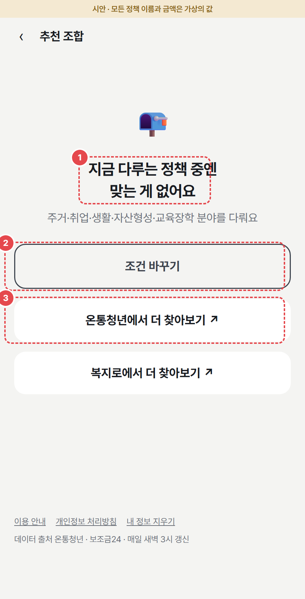

| 번호 | 요소 | 내용·동작 |
| --- | --- | --- |
| 1 | 안내 | 문구 S3-E1, S3-E2 |
| 2 | [조건 바꾸기] | S2-13 |
| 3 | 외부 링크 2개 | 온통청년, 복지로를 새 탭으로 |

### 4.6 S4 상황이 바뀌면?

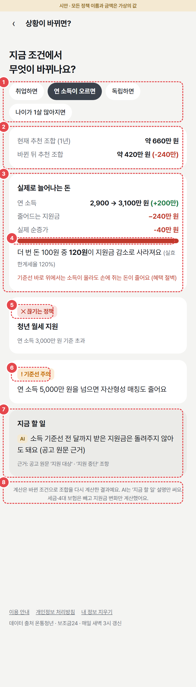

| 번호 | 요소 | 내용·동작 |
| --- | --- | --- |
| 1 | 상황 칩 | 취업하면 / 연 소득이 오르면 / 독립하면 / 나이가 1살 많아지면. 하나 선택, 처음엔 '취업하면'. 바꿀 때마다 서버에 다시 계산 요청 (계산 중엔 카드 자리에 로딩 표시) |
| 2 | 총액 비교 | 현재 추천 조합 총액 / 바뀐 뒤 추천 조합 총액 + 차이(줄면 빨강, 늘면 초록). 기준 기간은 S3에서 고른 기간 |
| 3 | 실제로 늘어나는 돈 | **소득이 바뀌는 상황(취업하면, 연 소득이 오르면)에서만.** 연 소득 변화 / 줄어드는 지원금 / 실제 순증가 |
| 4 | 실효한계세율 막대 | 비율만큼 빨간 막대 (100%에서 멈춤) + 문구 S4-T. 100% 이상이면 문구 S4-CLIFF 추가 |
| 5 | 끊기는 정책 카드 | ✕ + 정책 이름 + 이유. 없으면 카드 없음 |
| 그림 없음 | 새로 받는 정책 카드 | ＋ + 정책 이름 + 이유 (예: 취업하면 재직 청년 정책) |
| 6 | 기준선 주의 | "연 소득 ○○○○만 원을 넘으면 ○○ 정책도 끊겨요". 다음으로 가까운 기준선 |
| 7 | 지금 할 일 | 템플릿 안내 + 근거 조항. **공고 원문 근거가 있을 때만** |
| 8 | 계산 안내 | 문구 S4-NOTE |

- '연 소득이 오르면'은 정책 소득 기준선을 막 넘는 경우로 계산한다 (F06). 그래서 순증가가 마이너스로 나올 수 있다(혜택 절벽)
- '독립하면'은 이미 혼자 살면 "이미 혼자 살고 있어서 바뀌는 게 없어요"
- 화면 하단 작은 글씨: "세금·4대 보험은 빼고 지원금 변화만 계산했어요"

### 4.7 S5 정책 상세

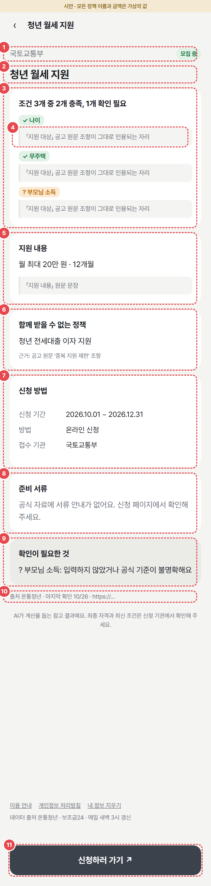

| 번호 | 요소 | 내용·동작 |
| --- | --- | --- |
| 1 | 기관·모집 상태 | 운영 기관 + 태그(모집 중 / 마감 D-n / 상시 / 모집 끝남) |
| 2 | 정책 이름 | |
| 3 | 내 자격 진단 | "조건 3개 중 2개 충족, 1개 확인 필요" + 조건별 진단 칩 |
| 4 | 원문 인용 | 조건마다 공고 원문의 해당 문장을 그대로 인용 (저장된 원문 근거) |
| 5 | 지원 내용 | 금액 요약 + 원문 문장 |
| 6 | 함께 받을 수 없는 정책 | 근거가 있을 때만. 정책 이름 + 근거 조항 |
| 7 | 신청 방법 | 신청 기간 / 방법 / 접수 기관 |
| 8 | 준비 서류 | 공식 자료에 있는 것만. 없으면 문구 S5-DOC |
| 9 | 확인이 필요한 것 | ? 조건마다 이유. 없으면 "없어요" |
| 10 | 출처·확인일 | "출처 온통청년 · 마지막 확인 10/26 · URL" |
| 11 | [신청하러 가기 ↗] | 하단 고정. 공식 신청 페이지를 새 탭으로. **모집이 끝난 정책이면** 버튼 글자를 [공식 페이지 보기 ↗]로 바꾸고 위에 문구 S5-CLOSED |

- 조건을 고르지 않고 주소로 바로 들어오면 3·4번 대신 "내 조건을 고르면 자격을 진단해 드려요" + [조건 고르기] → S2-1
- 없는 정책 ID면 문구 S5-404 + [처음으로]

### 4.8 공통 페이지

| 화면 | 내용 |
| --- | --- |
| P1 이용 안내 | 서비스의 검색·계산 방식 / 데이터 출처와 갱신 시각 / 최종 자격 확인 / 다루는 범위와 한계 (카드 4개) |
| P2 개인정보 처리방침 | 받는 정보 / 저장 위치(브라우저, 30일) / 서버 전달(판정에 필요한 조건만 사용, 생성형 AI API로 보내지 않음) / 이용 통계(구글 애널리틱스, 쿠키) / 지우는 방법 |
| P3 없는 페이지 | 문구 P3-01 + [처음으로] |
| 토스트 | 화면 아래에 1.8초 떴다 사라지는 짧은 알림 (저장 완료, 지움 완료 등) |

### 4.9 요소 상태

| 요소 | 기본 | 누름·선택 | 비활성 | 그 밖 |
| --- | --- | --- | --- | --- |
| 하단 고정 버튼 | 진한 배경 + 흰 글씨 | 살짝 어둡게 | 회색 배경, 누를 수 없음 | 분석 요청 중엔 글자 대신 도는 표시 |
| 선택지 (큰 목록) | 흰 배경 | 진한 배경 + 흰 글씨 + 오른쪽 ✓ | | |
| 칩 | 흰 배경 | 진한 배경 + 흰 글씨 | | |
| 체크박스 | 빈 네모 | 진한 네모 + ✓ | | 글자 전체를 눌러도 바뀜 |
| 입력칸 | 흰 배경 | 테두리 진하게 (포커스) | | |
| 드롭다운 | 흰 배경 | | 시·도 전에는 시·군·구 비활성 | |
| 조합 카드 | 흰 배경 | 진한 테두리 | | |
| 접기 목록 | 접힘 › | 펼침 (화살표 회전) | | |
| 링크 버튼 | 밑줄 | | | |

키보드: 모든 버튼·칩·체크는 Tab으로 이동하고 Enter·Space로 누른다. 포커스 테두리를 지우지 않는다.

### 4.10 화면 문구

말투는 해요체로 통일한다. `{ }`는 코드가 채우는 값이다.

| ID | 위치 | 문구 |
| --- | --- | --- |
| S1-01 | S1 소개 | 받을 수 있는 지원금, 가장 이득인 조합으로 찾아 드려요 |
| S1-02 | S1 설명 | 함께 받을 수 없는 정책은 빼고, 총액이 가장 큰 조합을 계산해요. |
| S1-03 | S1 순서 1 | 내 조건을 골라요 (약 3분) |
| S1-04 | S1 순서 2 | 함께 받을 수 있는 조합과 총액을 봐요 |
| S1-05 | S1 순서 3 | 신청 방법과 준비 서류까지 확인해요 |
| S1-AI | S1 서비스 안내 (기존 문구 ID 유지) | 선택한 조건으로 정책을 찾고 지원금 조합을 계산해요. 결과는 참고용이며 최종 자격은 신청 기관에서 확인해야 해요. [자세히] |
| S1-C1 | S1 필수 동의 | (필수) 선택한 조건은 정책 분석에만 사용돼요 [개인정보 처리방침] |
| S1-C2 | S1 기억하기 | (선택) 이 기기에 내 조건 기억하기 · 30일 동안, 언제든 지울 수 있어요 |
| S1-BTN | S1 버튼 | 시작하기 |
| S1-SAVED | S1 지난 조건 | 지난번 조건으로 바로 보기 · [이 조건으로 다시 보기] · [내 정보 지우기] |
| S2-T | S2 상단 바 | 조건 고르기 · {n} / 13 |
| S2-1 | 1단계 | 나이가 어떻게 되나요? · 만 나이로 적어 주세요 |
| S2-1-N | 1단계 범위 밖 | 청년(만 19 ~ 39세) 정책 위주라 받을 수 있는 게 적을 수 있어요. 그래도 계속 볼 수 있어요. |
| S2-1-M | 1단계 군 복무 | 군 복무를 마쳤나요? · 복무한 기간만큼 나이 기준을 늘려 주는 정책이 있어요 (연장 폭과 상한은 정책 공고마다 다르고, 공고에 없으면 확인 필요로 표시해요) |
| S2-2 | 2단계 | 어디에 사나요? · 주민등록상 주소 기준이에요 |
| S2-3 | 3단계 | 지금 상황은요? · 가장 가까운 것 하나를 골라 주세요 |
| S2-4 | 4단계 | 최종 학력은요? |
| S2-5 | 5단계 | 결혼했나요? · 신혼부부 기준이 따로 있거나, 결혼하면 부모님 소득을 안 보는 정책이 있어요 |
| S2-6 | 6단계 | 어떻게 살고 있나요? · 내 이름(또는 배우자)으로 된 집이 있나요? (분양권·입주권도 포함이에요) · 주민등록상 세대주인가요? |
| S2-7 | 7단계 | 지금 사는 집 계약은요? · 주거 정책은 보증금·월세 금액에 상한이 있어요 · 보증금 · 월세 |
| S2-8 | 8단계 | 본인 소득과 재산은요? · 구간만 골라요. 몰라도 괜찮아요 · 연 소득 (세전) · 재산 (예금·보증금·자동차 등을 더하고 대출은 빼요) |
| S2-9 | 9단계 | 해당하는 게 있나요? · 이런 분만 받을 수 있는 정책이 따로 있어요. 여러 개 고를 수 있어요 |
| S2-9-P | 9단계 안내 | 이 정보는 자격 계산에만 써요. 서버에 저장하지 않아요 |
| S2-10 | 10단계 | 어떤 지원에 관심이 있나요? · 여러 개를 고를 수 있어요 · 초기에는 취업·주거 혜택을 다뤄요 |
| S2-11 | 11단계 | 이미 받고 있거나 받았던 게 있나요? · 한 번만 받을 수 있거나 함께 가입할 수 없는 정책은 조합에서 빼요 |
| S2-12 | 12단계 | 더 정확하게 볼까요? · 일부 정책은 부모님(원가구) 소득·재산을 봐요. 모르면 '확인 필요'로 표시돼요 |
| S2-12-30 | 12단계 30세 이상 | . 만 30세 이상이면 안 보는 정책도 있어요 |
| S2-12-M | 12단계 기혼 | 부모님 정보 입력은 건너뛰어요 · 정책별 부모님 기준은 따로 확인해요 |
| S2-SKIP | 12단계 버튼 | 건너뛰기 |
| S2-13 | 13단계 | 이 조건으로 찾을까요? · 항목을 누르면 고칠 수 있어요 |
| S2-BTN | 버튼 | 다음 · (13단계) 내 조합 찾기 |
| L-01 | 로딩 제목 | 가장 이득인 조합을 계산하고 있어요 |
| L-02 | 로딩 설명 | 아래 단계로 정책을 찾고 계산하고 있어요 |
| L-E1 | 분석 실패 | 분석에 실패했어요. 잠시 후 다시 시도해 주세요 · [다시 시도] · [조건 수정] |
| L-E2 | 하루 상한 | 오늘 이용량이 많아 잠시 쉬어요. 내일 다시 이용해 주세요 · [처음으로] |
| S3-T | S3 상단 바 | 내 지원금 조합 · [조건 수정] |
| S3-01 | S3 제목 | 함께 받을 수 있는 조합 {n}개를 찾았어요 |
| S3-PV | 현재가치 | 현재가치로 보기 · 나중에 받는 돈을 지금 가치로 바꿔 비교해요 (할인율 연 {r}%) |
| S3-GIVE | 조합 카드 | 포기하는 지원금 · {정책 이름} {금액}만 원 |
| S3-W1 | 왜 이 순서 | 추천 조합은 대안 1보다 {기간} 동안 {차이}만 원 더 받아요. (현재가치를 켜면 끝에 "(현재가치 기준)") |
| S3-W2 | 왜 이 순서 | 추천 조합을 고르는 기회비용은 다음으로 좋은 대안 1의 약 {대안 1 총액}만 원이에요. 그보다 커서 1위예요. |
| S3-W3 | 왜 이 순서 | {A}과 {B}은 함께 받을 수 없어요. 그래서 둘 중 총액이 커지는 쪽을 골랐어요. |
| S3-W4 | 왜 이 순서 (2년·전체) | 기간을 바꾸면 매달·만기 지급 금액이 달라져 순위가 바뀔 수 있어요. |
| S3-W5 | 왜 이 순서 (현재가치 켬) | 만기에 한꺼번에 받는 적금 매칭금은 지금 받는 돈보다 가치가 작아요. 예) {정책} {원래 금액}만 원 → 지금 가치 약 {현재가치}만 원 |
| S3-LIST | 목록 제목 | {조합 이름}에 들어 있는 지원금 {n}개 |
| S3-MAT | 만기 지급 | 만기 시 지급 |
| S3-OLD | 오래된 정보 | ⚠ 최신 내용은 공식 페이지에서 확인 |
| S3-CK | 확인 필요 | ? 이 조합에서 확인이 필요한 부분 · '{A}'과 '{B}'은 함께 받을 수 있는지 공식 자료로 확인되지 않았어요. ({금액}만 원이 총액에 포함돼 있어요) |
| S3-F1 | 접기 1 | 이 조합에서 빠진 정책 {n}개 · {B}과 함께 받을 수 없어 빠졌어요 (공고 원문 근거). 이 조합의 기회비용 {금액}만 원 |
| S3-F4 | 접기 (모집 끝남) | 지금은 모집이 끝난 정책 {n}개 · 다음 모집 때 받을 수 있어요 · 지난 모집 {기간} · 다음 모집 {시기 또는 '미정'} |
| S3-F2 | 접기 2 | 조건이 맞지 않는 정책 {n}개 |
| S3-F3 | 접기 3 | 아직 조합 계산 전인 정책 {n}개 · 금액·중복 여부를 검수 중이예요. 정책별 자격 진단은 볼 수 있어요. |
| S3-BTN | 버튼 | 자세히 보기 · 신청하러 가기 ↗ · 상황이 바뀌면 어떻게 될까? · 결과 이미지로 저장 |
| S3-E1 | 결과 없음 | 지금 다루는 정책 중엔 맞는 게 없어요 |
| S3-E2 | 결과 없음 | 첫 MVP는 취업·주거 분야를 다뤄요 (생활·자산형성·교육장학은 확장 예정) · [조건 바꾸기] · [온통청년에서 더 찾아보기 ↗] · [복지로에서 더 찾아보기 ↗] |
| S4-01 | S4 제목 | 상황이 바뀌면? · 지금 조건에서 무엇이 바뀌나요? |
| S4-SUM | 총액 비교 | 현재 추천 조합 ({기간}) · 바뀐 뒤 추천 조합 |
| S4-NET | 실제로 늘어나는 돈 | 실제로 늘어나는 돈 · 연 소득 · 줄어드는 지원금 · 실제 순증가 |
| S4-T | 실효한계세율 | 더 번 돈 100원 중 {n}원이 지원금 감소로 사라져요 (실효한계세율 {n}%) |
| S4-CLIFF | 혜택 절벽 | 기준선 바로 위에서는 소득이 올라도 손에 쥐는 돈이 줄어요 (혜택 절벽) |
| S4-LOSE | 끊기는 정책 | ✕ 끊기는 정책 |
| S4-ADD | 새로 받는 정책 | ＋ 새로 받는 정책 |
| S4-WARN | 기준선 주의 | ! 기준선 주의 · 연 소득 {금액}만 원을 넘으면 {정책}도 끊겨요 |
| S4-TODO | 지금 할 일 | 지금 할 일 · 근거: 공고 원문 '{조항}' 조항 |
| S4-NOTE | 계산 안내 | 계산은 바뀐 조건으로 조합을 다시 계산한 결과예요. 안내는 공고 근거와 계산 결과로 정리했어요. 세금·4대 보험은 빼고 지원금 변화만 계산했어요. |
| S5-SUM | 진단 요약 | 조건 {n}개 중 {a}개 충족, {b}개 확인 필요 |
| S5-NOC | 조건 없이 들어옴 | 내 조건을 고르면 자격을 진단해 드려요 · [조건 고르기] |
| S5-DOC | 서류 없음 | 공식 자료에 서류 안내가 없어요. 신청 페이지에서 확인해 주세요. |
| S5-CK | 확인 필요 | ? {조건}: 입력하지 않았거나 공식 기준이 불명확해요 |
| S5-CLOSED | 모집 끝남 | 지금은 신청 기간이 아니에요. 다음 모집 때 신청할 수 있어요 (지난 모집 {기간}) |
| S5-404 | 없는 정책 | 찾는 정책이 없어요 · 마감됐거나 주소가 바뀌었을 수 있어요 · [처음으로] |
| S5-LINK | 링크 오류 | 공식 페이지가 열리지 않아요. 기관 이름으로 검색해 주세요 |
| P3-01 | 없는 페이지 | 페이지를 찾을 수 없어요 · 주소를 다시 확인해 주세요 · [처음으로] |
| COM-AI | 결과·상세 하단 | 검수한 정책과 입력 조건으로 계산한 참고 결과예요. 최종 자격과 최신 조건은 신청 기관에서 확인해 주세요. |
| COM-FOOT | 하단 메뉴 | 이용 안내 · 개인정보 처리방침 · 내 정보 지우기 · 데이터 출처 온통청년 · 보조금24 · 매일 새벽 3시 갱신 |
| T-CLEAR | 토스트 | 이 기기에 저장된 내 정보를 지웠어요 |
| T-IMG | 토스트 | 결과 이미지를 저장했어요 |

---

## 5. 기능 상세 요구사항

세부 완료 기준은 담당 개발자가 PR에 적는다. 아래 완료 기준은 기능이 끝났다고 보기 위한 최소 조건이다.

### F01. 조건 선택 입력

- 주 담당: 이현서 (프론트엔드)
- 협업: 김하정 (백엔드), 윤정찬 (코드표·구간)

#### 기능 설명
사용자가 한 화면에 질문 하나씩, 선택지로 조건을 고른다.
마지막에 고른 조건을 요약해 보여 주고, 항목을 눌러 고칠 수 있다.

#### 입력 (13단계)

- 단계별 질문·선택지·필수 여부: **4.3 S2 조건 선택** 표
- 서버로 보내는 형식: 6.1
- 3·4·5·9단계 선택지는 온통청년 API 코드(취업 요건, 학력 요건, 혼인 상태, 특화 요건)와 1:1로 맞춘다
- 소득·재산·보증금·월세는 정확한 금액이 아니라 구간으로 받는다. 구간 경계는 실제 정책 기준선에 맞춘다 (예: 재산 1억 2천만 원 = 청년월세 청년가구 재산 기준, 3억 4,500만 원 = 버팀목 순자산 기준)
- 소득은 **금액 구간으로 묻고, 코드가 가구원 수와 기준 중위소득표로 % 구간을 계산**한다 (사용자는 자기가 중위소득 몇 %인지 모른다)

#### 처리
1. 단계마다 필수 값을 확인하고, 다 고르기 전에는 [다음]을 막는다.
2. 나이가 19 ~ 39세 밖이면 안내하되 막지 않는다.
3. '모름'이나 건너뛴 값은 미입력(null)으로 둔다.
4. 13단계에서 [내 조합 찾기]를 누르면 조건을 서버로 보내고 분석 화면으로 간다.
5. 새로고침·뒤로 가기에도 고른 값과 마지막 결과를 유지한다(탭을 닫으면 사라짐).

#### 출력
- 구조화된 사용자 조건 (JSON)
- 조건 요약·수정 화면

#### 완료 기준
- [ ] 13단계 모두 선택지로 입력 가능 (모바일, PC)
- [ ] 필수 값 없이 다음 단계로 넘어가지 않음
- [ ] 35세 이상일 때만 군 복무 질문, 기혼이면 12단계 생략
- [ ] 미입력 값을 임의로 채우지 않음
- [ ] 13단계에서 항목을 눌러 수정하면 분석에 반영됨

### F02. 정책 검색

- 주 담당: 김하정 (DB 조회·검색 구현)
- 협업: 윤정찬 (수집·출처), 탁서윤 (수집 데이터 분석·조건 구조화·정제·품질)

#### 기능 설명
구조화한 정책 DB에서 사용자에게 해당할 수 있는 취업·주거 정책 후보를 찾고, 저장된 공고 문장·중복 제한·신청 방법의 근거를 연결한다. SQL 조건 검색을 기본으로 하고 벡터 검색이나 답변 생성을 요구하지 않는다.

#### 입력
- 선택된 사용자 조건, 관심 분야

#### 처리
1. 지역·나이·분야 등 구조화된 필드로 후보를 조회한다. 확실히 미충족인 경우만 제외하며, 군 복무 연장·미상·예외 조건이 있는 정책을 기본 나이 상한만으로 버리지 않는다.
2. 수집·검수 단계에서 연결한 조건별 원문 인용과 출처 버전을 조회한다. 근거가 없는 조건은 F04에서 확인 필요로 남긴다.
3. 검색 점수나 상위 k개 표시 제한으로 검수된 조합 후보를 잘라 전역 최적값을 놓치지 않는다.
4. 후보가 없으면 결과 없음으로 처리한다. 조회 실패는 결과 없음과 구분한다.

#### 출력
- 후보 정책, 근거 문장, 공식 URL, 확인일·문서 버전

#### 완료 기준
- [ ] 공식 정책의 구조화된 조건으로 후보를 조회한다
- [ ] 진단·상세의 인용문이 저장된 원문 및 해당 버전과 일치한다
- [ ] 미상·예외 조건을 임의 탈락시키지 않는다
- [ ] 결과 없음과 조회 실패를 구분한다

### F03. 분석 흐름·진행 상태

- 주 담당: 김하정 (애플리케이션 흐름·SSE)
- 협업: 윤정찬·탁서윤 (데이터·근거 품질), 이현서 (진행 화면)

#### 기능 설명
일반 백엔드 코드가 검색·진단·계산의 순서와 필요한 분기를 실행한다. 단계별 진행 이벤트를 SSE로 보내며, 정책이 없거나 미확인인 경우와 오류를 명시적으로 처리한다. AI가 다음 도구를 선택할 필요는 없다.

#### 처리 함수와 화면 진행

| 처리 | 하는 일 | 구현 | 화면 진행 문구 |
| --- | --- | --- | --- |
| search_policies | 조건·관심 분야의 후보 조회 | 구조화 DB 검색 | 내 조건에 맞는 정책 찾는 중 |
| get_policy_detail | 상세·근거 조회 | DB | 정책 내용 확인 중 |
| check_eligibility | 충족·미충족·확인 필요 | 판정 코드 | 자격 조건 비교 |
| optimize_portfolio | 최적 조합·금액·현재가치 | 계산 코드 | 함께 받을 수 있는 조합 계산 |
| simulate_change | 바뀐 조건의 재계산·연간 변화 | 계산 코드 | 바뀐 상황으로 다시 계산 |
| get_application_guide | 공식 신청 안내 조회 | DB | 신청 방법 정리 중 |
| 설명 정리 | 판정 결과와 근거를 문장으로 표시 | 템플릿 | 추천 이유 정리 |

#### 처리
1. 요청 종류에 맞는 함수를 실행한다. 모든 요청에서 모든 함수를 호출할 필요는 없다.
2. 실제 실행 단계에 맞춰 running·done 이벤트를 보내고 최종 result를 한 번 반환한다.
3. 숫자·상태는 판정·계산 코드의 결과를 사용한다. 설명이 결과를 변경하지 않는다.
4. 실패 시 공통 오류로 종료하고 실패 뒤 성공 결과를 보내지 않는다.
5. 특수 조건·부모님 소득·재산은 서버 판정에만 사용하고 설명·진행 이벤트·외부 AI·로그에 포함하지 않는다.

#### 출력
- 진행 이벤트, 분석 결과 JSON, 근거에 연결된 추천 이유

#### 완료 기준
- [ ] 화면 진행 상태가 실제 실행 단계와 일치한다
- [ ] DB와 가상 자료만으로 흐름을 검증할 수 있으며 LLM 키가 필요하지 않다
- [ ] 설명의 숫자·근거가 계산 결과와 일치한다
- [ ] 미확인·빈 결과·실패 분기를 구분한다
- [ ] SSE 오류 뒤 result를 보내지 않는다

### F04. 자격 진단

- 주 담당: 김하정 (백엔드)
- 협업: 윤정찬·탁서윤 (DB·코드표·판정 근거), 이현서 (화면)

#### 기능 설명
사용자 조건과 정책 조건을 비교해 조건마다 판정하고 근거와 함께 보여 준다.

#### 처리 규칙
1. 조건마다 충족(✓, `met`) / 미충족(✕, `not_met`) / 확인 필요(?, `needs_review`)로 판정한다.
2. '모름'·건너뛴 값이 필요하면 확인 필요. 미입력을 충족으로 처리하지 않는다.
3. 기준이 문장뿐이라 코드로 판정할 수 없으면 확인 필요 + 원문 인용.
4. 나이 상한(군 복무 연장): 고른 칩을 `domain_data.military_months_range {min, max}`로 보낸다(해당 없음 0..0, 1년 6개월 이하 0..18, 1년 6개월 초과 ~ 2년 19..24, 2년 초과 25..null, 미상은 전체 null). 확정 개월값을 추정해 상한에 더하지 않는다. 정책별 공고 근거에 있는 연장 상한을 적용한 뒤, 구간 안 모든 가능 값에서 상한을 넘지 않으면 `met`, 모두 넘으면 `not_met`, 갈리거나 공고 기준이 불명확하면 `needs_review`로 판정한다. 35세 미만이라 수집하지 않은 값은 0으로 추정하지 않으며, 연장이 판정에 필요하면 `needs_review`로 남긴다.
5. 소득: 금액 구간을 중위소득 %로 바꿔 비교. 공고 연산자(≤ vs <)와 구간 끝 포함 여부(explicit `inclusive`)대로 판정한다. 경계값 일치(=) 자체는 확인 필요 사유가 아니며, 전 구간 값이 통과하면 `met`, 전부 실패하면 `not_met`이다. 구간이 기준선을 가로지를 때(일부는 통과·일부는 실패)만 `needs_review`로 남긴다.
6. 기혼이면 12단계 UI는 생략하되, 원가구 면제는 공고별로 판정한다. '만 30세 이상은 본인 가구만' 같은 예외는 공고 근거가 있을 때만 적용하고, 근거가 불명확하면 `needs_review`로 남긴다.
7. 이미 받은 정책이 '생애 1회'이거나 같은 계열 중복 가입이 안 되면 미충족.
8. 정책이 요구하는 특수 조건(수급자 등)을 고르지 않았으면 미충족.
9. 미충족이 하나라도 있으면 조합 후보에서 빠지고 '조건이 맞지 않는 정책'으로 간다.

#### 출력
- 정책별 조건 판정 목록, 근거 문장, 확인이 필요한 이유

#### 완료 기준
- [ ] 나이·지역·상황·학력·혼인 조건을 코드로 판정한다
- [ ] 미입력 정보를 충족으로 처리하지 않는다
- [ ] 군 복무 연장이 연장 인정 정책에만 적용된다
- [ ] 화면에 기호·색·글자로 상태가 함께 표시된다
- [ ] AI가 진단 결과를 바꾸지 않는다

### F05. 최적 조합

- 주 담당: 김하정 (백엔드)
- 협업: 윤정찬·탁서윤 (검수 데이터·중복 제한 근거), 이현서 (화면)

#### 기능 설명
자격이 되는 정책 중 함께 받을 수 있는 조합을 만들고,
기간 총액이 큰 순서로 추천 1개 + 대안 2개를 보여 준다.

#### 처리 규칙
1. 대상: 미충족이 없고, 검수 완료(reviewed)이며, **지금 신청할 수 있는(모집 중·상시) 정책.**
2. 모집이 끝난 정책은 조합에서 빼고 '지금은 모집이 끝난 정책'으로 따로 보여 준다 (지난 모집 기간, 알려진 경우 다음 모집 시기).
3. 공식 근거로 함께 받을 수 없는 쌍은 같은 조합에 넣지 않는다.
4. 함께 받을 수 있는지 근거가 없는 쌍은 넣고 '확인 필요'로 표시한다.
   - 이 표시는 동시 수급 확정이 아니다. API 필드 누락도 이 미확인 상태로 다룬다. 데이터 분석에서 발견한 조건부·기간별·과거 수급 제한·차감 규칙은 단순 영구 금지 쌍으로 바꾸지 않고 적용 조건을 검수한다. 현재 계약이 지원하지 못하는 규칙은 검수 대기로 남기며, 이 처리 범위는 6장 계약 검토 때 정한다.
5. 금액 미상 정책은 조합 총액에 넣지 않고 0원으로도 보지 않는다. 조합 내 `total_won`은 검수 확정 금액의 합이며, 미상 정책은 기능상 계속 노출하되 `not_yet_reviewed`/'아직 조합 계산 전인 정책' 목록으로 따로 보여 준다. 전역 전체 수급액을 확정된 최대값으로 표시하지 않으며, 검수 금액 후보 안의 최대와 미상 정책 보완 목록을 구분한다.
6. 다른 정책을 더 넣을 수 있는 작은 묶음은 후보로 치지 않는다 (최대 3개는 서로 다른 '꽉 찬 묶음'). 유효한 조합이 1~2개면 그 수만 보여 주고 채우기용 조합을 만들지 않는다.
7. 점수 = 고른 기간(1년 / 2년 / 전체) 동안 받는 금액 합. 현재가치를 켜면 현재가치 합. 기간을 바꾸면 순위도 다시 매긴다.
8. 점수가 같으면 확인 필요 쌍이 적은 조합 → 정책 수가 적은 조합 순.
9. 꽉 찬 묶음이 1 ~ 2개뿐이면 있는 만큼만 보여 준다.
10. 두 정책 이상을 함께 받을 조합이 없으면(후보 1개뿐이거나 후보끼리 모두 충돌하는 경우 등) 받을 수 있는 정책을 최대 5개 목록으로 보여 준다 (`fallback_list`).
11. 후보 전체를 정확 탐색한다. 임의로 후보를 잘라낸 결과를 최적 조합으로 보내지 않는다. 안전 가지치기(중복 제한·모집 상태로 겹칠 수 없는 묶음을 미리 제외)나 분지 한계 같은 정확한 탐색 최적화는 쓸 수 있다. 시간·자원을 초과하면 `calculation_limit_exceeded`로 실패를 알리고, 잘린 후보로 계산한 총액을 최적이라고 표시하지 않는다. 60초 초과 실패 원칙은 유지한다. (회귀 사례: 서로 받을 수 없는 정책 20개(각 100만 원)와 21번째 호환 정책(99만 원)이면 전역 최적은 199만 원이다. 금액 상위 20개만 자르면 100만 원이 1위가 되는 잘못된 결과가 나온다.)
12. 결과가 0개면 "지금 다루는 정책 중엔 맞는 게 없어요" + 조건 바꾸기 + 온통청년·복지로 링크.

#### 기간 금액

| 지급 방식 | 1년 | 2년 | 전체 |
|---|---|---|---|
| 매달 | 월 금액 × min(지급 개월, 12) | × min(지급 개월, 24) | 총 지급액 |
| 일시금 | 전액 | 전액 | 전액 |
| 만기 지급 | 그 기간까지 쌓인 금액 (만기 전이면 예상 적립액으로 표시) | 같은 방식 | 만기 전액 |
| 이자 지원 | 연 지원액 × min(1, 지원 연수) | 연 지원액 × min(2, 지원 연수) | 연 지원액 × 지원 연수 |

'전체 기간'은 정책마다 끝까지 받는 금액이다. 지원 기간을 초과해 곱하지 않는다(예: 지원 2년이면 전체도 연 지원액 × 2). 만기 지급은 화면에 '만기 시 지급'을 붙이고, 만기 전 매칭분은 받을 돈이 아니라 예상 적립액임을 구분해 표시한다.

#### 현재가치 (화면의 '현재가치로 보기', 처음엔 꺼짐)
- m개월 뒤 받는 금액 A의 현재가치 = A ÷ (1 + r)^(m ÷ 12)
- 실제 현금이 지급되는 시점을 기준으로 할인한다. 매달 지급은 달마다, 만기 지급은 만기 달에, 이자 지원은 해마다 할인한다. 만기 전 적립 매칭분은 할인 대상 현금 지급이 아니라 예상 적립액으로 표시한다
- r = 한국은행 기준금리 (매일 자동 갱신). 기준금리가 미확인이면 r을 0으로 가정하지 않고 `discount_rate: null, discount_rate_status: unknown`으로 둔다. 화면에 "할인율 연 ○.○%" 표시
- 계산·계약은 정책별 할인 금액을 원 단위로 반올림하고 그 정수 금액을 합산한다. 화면에서만 만 원 단위로 표시하며, 화면 반올림값을 다시 합산해 순위를 바꾸지 않는다

#### 포기하는 지원금 (기회비용)
- 조합에 없는 정책 중, 조합 안 정책과 '함께 받을 수 없는' 정책과 그 금액
- "왜 이 순서인가요?": 1위와 2위의 총액 차이, 1위를 고르는 기회비용(= 2위 총액), 둘을 가른 '함께 받을 수 없는 쌍'
- 동시에 받을 수 없어 빠진 정책의 금액을 합해 받을 수 있는 총액처럼 표시하지 않는다. 기회비용은 놓치는 금액이라는 설명을 함께 보여 준다

#### 출력
- 조합 최대 3개 (총액, 구성, 정책별 금액·진단·추천 이유, 포기하는 지원금, 확인 필요 쌍)
- 이 조합에서 빠진 정책 / 모집이 끝난 정책 / 조건이 맞지 않는 정책 / 아직 조합 계산 전인 정책
- 기간 3개 × 현재가치 켬·끔 6가지 결과를 한 번에 (화면에서 바꿀 때 다시 묻지 않도록)

#### 완료 기준
- [ ] 함께 받을 수 없는 정책이 같은 조합에 들어가지 않는다
- [ ] 모집이 끝난 정책이 조합에 들어가지 않는다
- [ ] 8.3 정답 테스트 사용자 8개의 조합과 총액이 정답과 같다
- [ ] 기간·현재가치를 바꾸면 총액과 순위가 바뀐다
- [ ] 동시 수혜를 근거 없이 확정하지 않는다 ('확인 필요' 표시)

### F06. 상황 변화 분석 (혜택 절벽)

- 주 담당: 김하정 (백엔드)
- 협업: 탁서윤 (변경 조건·안내 근거 검수), 이현서 (화면)

#### 기능 설명
조건이 바뀌면 받을 수 있는 조합과 총액이 어떻게 달라지는지,
소득이 오를 때 실제로 손에 쥐는 돈이 얼마나 늘어나는지 보여 준다.

#### 상황

| 상황 | 바꾸는 조건 |
|---|---|
| 취업하면 | 지금 상황 → 재직, 연 소득 0 → 2,400만 원 (기본값) |
| 연 소득이 오르면 | 지금 소득 구간 안에 정책 소득 기준선이 있으면 기준선 −100만 원 → +100만 원 (예: 2,900 → 3,100만 원). 없으면 지금 구간 가운데 값 → 다음 구간 가운데 값 |
| 독립하면 | 사는 형태 → 혼자, 집 계약 → 월세 (보증금·월세는 가장 흔한 구간) |
| 나이가 1살 많아지면 | 나이 + 1 |

#### 처리
1. 바꾼 조건으로 F04·F05를 다시 돌려 1위 조합끼리 비교한다.
2. 끊기는 정책, 새로 받는 정책, 다음으로 가까운 기준선을 찾는다.
3. 연 소득 증가분이 양수인 상황에서 실효한계세율과 실제 순증가를 계산한다. 증가분이 0·음수이거나 필요한 금액이 미상이면 비율을 `null`로 두고 계산 근거 부족을 표시한다.
   - 실효한계세율(%) = (바뀌기 전 1위 1년 총액 − 바뀐 뒤 1위 1년 총액) ÷ 늘어난 연 소득(1년) × 100
   - 실제 순증가 = 늘어난 연 소득(1년) − 줄어든 1년 지원금. 2년·전체 기간 총액을 연 소득 1년 증가분과 직접 나누거나 빼지 않는다. 선택 기간 총액 카드와 1년 기준 비교는 화면에서 구분해 표시하고, 응답의 `basis_period`로 기준 기간을 명시한다
   - 100% 이상이면 '혜택 절벽'을 알린다
4. '기준선 주의'는 바뀐 조건에서 다음으로 가까운 소득·나이 기준선 하나.
5. 세금·4대 보험은 넣지 않는다 (화면에 표시).
6. '지금 할 일'은 공고 원문 근거가 있을 때만 템플릿으로 정리한다. 근거가 없으면 빈칸.

#### 출력
- 바뀌기 전·후 총액, 연 소득 변화, 줄어드는 지원금, 실제 순증가, 실효한계세율
- 끊기는·새로 받는 정책, 기준선 주의, 지금 할 일(근거 포함)

#### 완료 기준
- [ ] 상황 4개 모두 다시 계산된다
- [ ] 8.3 테스트 사용자 F·G의 실효한계세율이 정답과 같다
- [ ] 근거 없는 '지금 할 일'을 보여 주지 않는다

### F07. 정책 상세·신청 안내

- 주 담당: 김하정 (백엔드)
- 협업: 윤정찬 (수집·DB), 탁서윤 (정제·근거 품질), 이현서 (화면)

#### 기능 설명
정책 하나의 자격 진단과 신청 준비를 한 화면에 보여 준다 (보조금24 상세 순서).

#### 처리
1. 정책 ID로 상세를 조회한다.
2. 조건별 진단과 각 조건의 공고 원문을 그대로 인용한다.
3. 지원 내용, 함께 받을 수 없는 정책(근거 있을 때), 신청 기간·방법·접수 기관을 보여 준다.
4. 준비 서류는 공식 자료에 있는 것만. 없으면 "공식 자료에 서류 안내가 없어요".
5. 모집이 끝난 정책이면 "지금은 신청 기간이 아니에요"와 [공식 페이지 보기].
6. 조건을 고르지 않고 주소로 바로 들어오면 진단 대신 [조건 고르기].

#### 출력
- 정책명, 운영 기관, 모집 상태, 진단, 원문 인용, 지원 내용, 신청 방법, 준비 서류, 확인 필요 사항, 출처 URL, 마지막 확인일

#### 완료 기준
- [ ] 공식 자료에 없는 서류를 만들어내지 않는다
- [ ] 공식 신청 페이지가 새 탭으로 열린다
- [ ] 모집이 끝난 정책에 신청 버튼을 보여 주지 않는다

### F08. 매일 자동 갱신

- 주 담당: 양승현 (자동화 실행·스케줄·재시도·실패 알림)
- 협업: 윤정찬 (원천 수집·출처·원본), 탁서윤 (Agent 원문 분석·규칙 추출·정제·품질 평가), 김하정 (API·DB·계산 연동)

#### 처리 (매일 새벽 3시 KST, 실행 스케줄러는 추후 선택)
1. 온통청년·보조금24 API에서 취업·주거 정책 수집 (연령 조건이 19 ~ 39세와 겹치는 것). 겹치는 정책은 하나로 합친다.
2. 원문 해시를 비교해 바뀐 정책만 골라낸다.
3. API 응답으로 확인되지 않는 조건은 연결된 공식 공고·사업 지침·FAQ를 보완 수집한다. 이 문서들의 버전 변경도 추적한다.
4. 바뀐 원문의 조건·금액·중복 제한·예외를 Agent로 분석하고 규칙 후보와 근거를 만든다. 형식·인용·정책 연결을 검사하고 사람이 검수한 것만 게시한다. 실패·상충·미지원 조건은 검수 대기로 남긴다. 임베딩·벡터 DB는 필수로 정하지 않는다.
5. 원문이 바뀌면 연결된 정책·규칙의 검수를 해제하고 재검수 목록에 올린다. 구조화 조건·근거·검색용 데이터는 게시 버전에 맞춰 갱신하며 계산에 초안을 섞지 않는다.
6. 모집 상태를 오늘 날짜로 다시 계산한다.
7. 한국은행 ECOS에서 기준금리를 받는다.
8. 결과를 디스코드로 보고한다 (새 정책, 바뀐 정책, 재검수 필요, 실패 여부).

실패하면 전날 데이터를 그대로 쓰고 디스코드에 알린다. 화면의 '마지막 확인일'은 정책별 `verified_at`.

#### 완료 기준
- [ ] 사람이 손대지 않아도 매일 실행된다
- [ ] 변경된 정책의 조건·근거·검색용 데이터만 갱신한다
- [ ] Agent 추출 후보와 검수·게시 데이터를 구분하며, 원문 변경·근거 누락·상충·조건부 예외 사례를 검증한다
- [ ] 중복 제한·예외의 추출 정답과 그 규칙을 적용한 가상 조합 정답을 각각 검증한다
- [ ] 실패 시 디스코드 알림이 온다

### F09. 이 기기에 기억하기

- 주 담당: 이현서 (프론트엔드)

#### 처리
1. 시작 화면에서 '기억하기'를 켰을 때만, 분석을 시작하는 순간 저장한다.
2. 저장 위치는 사용자 브라우저뿐이다. 서버에는 저장하지 않는다. localStorage 키 `ypm.conditions.v1`, 값 `{ "saved_at": "날짜", "conditions": 6.1 계약 형식(profile) }`
3. 저장한 지 30일이 지나면 다음 접속 때 지운다.
4. 저장된 조건이 있으면 시작 화면에 "지난번 조건으로 바로 보기".
5. 모든 화면 하단 [내 정보 지우기]로 저장값과 마지막 결과를 바로 지운다 (토스트 T-CLEAR).
6. 마지막 분석 결과는 sessionStorage `ypm.lastResult`에 둔다. 새로고침·뒤로 가기 때 다시 분석하지 않는다. 탭을 닫으면 사라진다.

#### 완료 기준
- [ ] 끄면 아무것도 저장하지 않는다
- [ ] 30일 뒤 자동 삭제, [내 정보 지우기] 즉시 삭제

### F10. 결과 이미지 저장

- 주 담당: 이현서 (프론트엔드)

#### 처리
1. 실제 존재하는 조합 비교 카드(최대 3개)와 지금 고른 조합의 지원금 목록만 PNG로 저장한다.
2. 입력한 조건(부모님 정보 등)은 그림에 넣지 않는다.
3. 그림 아래 "청년 정책 매니저 · AI 참고 결과 · 생성일 2026.10.26". 파일 이름 `청년정책매니저_조합_20261026.png`.

#### 완료 기준
- [ ] 모바일·PC에서 저장된다
- [ ] 그림에 사용자 조건이 들어가지 않는다

### F11. 배포·통합

- 주 담당: 조장
- 협업: 팀원 전원

#### 처리
1. 화면·서버를 정해진 배포 대상에 배포하고 외부에서 접속 가능하게 한다 (배포 서비스는 미정, Render는 후보).
2. 하루 분석 상한: 서버 전체 **100회** (자정 KST 초기화). 넘으면 "오늘 이용량이 많아 잠시 쉬어요".
3. 구글 애널리틱스(조장 계정)를 연결하고 팀원에게 보기 권한을 준다. 사용자 조건 값은 보내지 않는다.
4. API 키는 환경변수로 관리한다.
5. 카톡 등 링크 미리보기(서비스 이름, 한 줄 소개 S1-01, 대표 이미지) 메타 태그.

#### 완료 기준
- [ ] 외부 네트워크에서 처음부터 신청 링크까지 전체 흐름이 된다
- [ ] 정책 검색·분석 흐름·진행 상태가 배포 환경에서 LLM 없이 동작한다
- [ ] API 키가 공개되지 않는다
- [ ] 평가자가 README만 보고 테스트할 수 있다

---

## 6. 데이터 형식과 API (기획 기준 + 계약 연결)

이 장의 화면 값·금액 단위·판정 규칙은 기획 기준(사용자 승인)으로 유지한다. 필드 이름과 자료형의 정본은 `contracts/v1/*.schema.json`이며, 가상 예제는 `contracts/fixtures/`를 링크로 참조한다(예제 중복 게재 금지). 계약 담당이 `contracts/v1`과 fixtures를 확장했으므로, 이 장은 중복 정의 대신 기획 필드 → 계약 필드 매핑으로 의미를 보존한다. 이 매핑은 개발용 정렬 초안이며 다음 회의에서 확정한다. 금액은 모두 원 단위 정수.

### 6.1 사용자 조건 (화면 → 서버)

정본: 요청 예제 [`contracts/fixtures/recommendation-request.json`](../../contracts/fixtures/recommendation-request.json), 스키마 [`contracts/v1/recommendation-request.schema.json`](../../contracts/v1/recommendation-request.schema.json) + [`contracts/v1/youth-profile.schema.json`](../../contracts/v1/youth-profile.schema.json). 아래 표는 기획 선택지(4.3·5장)의 의미를 계약 필드로 옮긴 것으로, 선택지 범위와 단위를 그대로 보존한다. 이 매핑은 개발용 정렬 초안이며 다음 회의에서 확정한다.

| 기획 선택지 | 계약 필드 | 의미 보존 |
| --- | --- | --- |
| 나이(만, S2-1) | `profile.age` | 만 나이 정수. 19~39세 밖이어도 막지 않고 안내만 한다 |
| 군 복무 칩(S2-1, 35세 이상) | `profile.domain_data.military_months_range {min, max}` | 해당 없음 0..0, 1년 6개월 이하 0..18, 1년 6개월 초과 ~ 2년 19..24, 2년 초과 25..null, 미상은 전체 null. 확정 상한값(18/24/30)을 단정해 보내지 않는다 |
| 지역(S2-2) | `profile.region_code`(시군구 또는 시도) 단일 + `domain_data.region {sido_code}`(상위 피커만) | 행정표준코드. 시·도 17개 → 시·군·구. `domain_data.region.sigungu_code` 중복은 계약에서 제거 |
| 지금 상황(S2-3) | `profile.employment_status` | 온통청년 jobCd 대응. high_school / student / grad_student / job_seeker / employed / short_term_worker / self_employed / freelancer / founder / farmer / other |
| 최종 학력(S2-4) | `domain_data.school` | schoolCd 대응 |
| 결혼(S2-5) | `domain_data.marital` | mrgSttsCd 대응. single / married / marrying_soon |
| 사는 형태·집 소유·세대주(S2-6) | `domain_data.housing {living, home_ownership, household_head}` | 분양권·입주권 포함, 세대주 구분 유지 |
| 집 계약·보증금·월세(S2-7) | `domain_data.contract {type, deposit_band, rent_band}` | 구간 경계는 실제 정책 기준선 유지. `*_band` 값 이름은 `GET /api/v1/options`가 내려 주는 value 그대로 쓴다 |
| 본인 소득·재산(S2-8) | `profile.income_band` + `domain_data.asset_band` | 금액 구간으로 묻고 코드가 중위소득 %로 변환. 모름 → unknown, 건너뜀 → null |
| 해당 조건(S2-9) | `domain_data.special` | sbizCd 대응. '해당 없음' → none(단독). 민감 정보이므로 LLM·임베딩·GA·로그에 보내지 않는다 |
| 관심 지원(S2-10) | `domain_data.interests` | housing / employment (초기 MVP 선택값). 나머지 분류는 확장 시 계약·선택지를 함께 갱신 |
| 받은 정책(S2-11) | `domain_data.received` | '없음' → none. 생애 1회·중복 가입 판정용 |
| 가구·부모님 정보(S2-12) | `domain_data.household {household_size, parent_income_band, parent_asset_band}` | 가구원 수 4는 4명 이상. 선택·건너뜀 가능, 기혼이면 null. 민감 정보이므로 LLM·임베딩·GA·로그에 보내지 않는다 |
| 기간 탭·현재가치(S3) | 요청 `options {period, present_value}` | 1y / 2y / all. 서버는 3기간 × PV on/off 6가지 결과를 응답에 모두 담는다 |

- 모르는 값과 건너뛴 값은 `null`(미상)로 두고 `0`·무소득·미충족으로 바꾸지 않는다
- 문장 입력이 없으므로 요청에 `message` 필드가 없다(계약에서 삭제됨). `domain`·`profile`·`options`가 원본이다
- 미배포 `limit` 필드는 계약에서 삭제했으므로 보내지 않는다
- 코드표·중위소득표·구간 경계는 정찬·하정이 계약 fixtures 기준으로 관리하고, 바꾸면 이 표와 4.3 단계별 질문 표를 함께 고친다

### 6.2 정책

노출 형식의 정본은 [`contracts/v1/benefit.schema.json`](../../contracts/v1/benefit.schema.json)과 예제 [`contracts/fixtures/youth-benefit.json`](../../contracts/fixtures/youth-benefit.json)이다 (개발 기준, 회의 확인 필요 초안). 아래는 수집·검수용 기획 형식으로, 계약 형식과의 의미 매핑을 함께 둔다.

```json
{
  "policy_id": "P-0001",
  "title": "정책 이름",
  "organization": "운영 기관",
  "category": "housing",
  "recruit_status": "open",
  "deadline": "2026-12-31",
  "reviewed": true,
  "benefit": {
    "type": "monthly",
    "amount_won": 200000,
    "period_months": 12,
    "max_total_won": 2400000,
    "pay_timing": "monthly_from_start",
    "amount_text": "월 최대 20만 원, 최장 12개월",
    "amount_status": "verified"
  },
  "conditions": [
    { "key": "age", "min": 19, "max": 34, "military_extension": true, "evidence": "공고 원문 문장" }
  ],
  "conflicts": [ { "policy_id": "P-0006", "evidence": "공고 원문 문장" } ],
  "lifetime_once": true,
  "application": { "start": "2026-10-01", "end": "2026-12-31", "method_text": "온라인 신청", "office": "접수 기관" },
  "documents": [],
  "source": "온통청년",
  "source_url": "https://...",
  "verified_at": "2026-10-26"
}
```

- `recruit_status`: open(모집 중) / always(상시) / closed(모집 끝남). 마감 14일 이내면 화면이 'D-n' 표시. 자동화가 매일 신청 기간과 오늘 날짜로 다시 계산한다
- `next_expected`: 다음 모집 예정 시기(공고에 있을 때만, 없으면 null)
- `benefit.type`: monthly / lump_sum / maturity / interest
- `pay_timing`: monthly_from_start / at_maturity / yearly / once (현재가치 계산용, 정찬이 검수 때 채움)
- `amount_status`: verified / unknown
- `reviewed`: 금액·중복 제한·지급 시점 검수 완료. true만 조합 계산에 들어감

기획 형식 → 계약 형식 매핑: `policy_id` → 혜택 `id`(`youth:출처:외부ID`); `organization` → `provider`; `category` → `categories`; `benefit` → `benefit_amount`(금액·기간·지급 시점·확인 상태); `conditions[]` → `eligibility_conditions`(조건 ID·설명·근거); `conflicts[]` → `conflicts`(근거); `lifetime_once` 유지; 모집 상태·기간·신청 URL → `application`; 원문 URL·확인 시각·문서 버전 → `source {url, checked_at, document_version}`; 조건별 근거 문장 → `evidence {quote, source}`. 상시 모집은 계약의 `application.status: open`과 공식 상시 근거로 표현하고 `always` 값은 보내지 않는다.

수치 조건의 연산자·상하한·복무 연장 규칙, 다음 모집 시기·신청 방법·접수 기관·준비 서류는 위 수집 초안의 기획 요구로 보존한다. 현재 공용 혜택 스키마에는 이 세부 항목의 자료형이 아직 없다. 구현 전에 담당자들이 조건 판정용 규칙과 상세 안내 계약을 함께 확장하고 fixtures·테스트로 확인한다. 현재 스키마에 없는 필드를 그대로 보내거나, 변환 중 정보를 버려서는 안 된다.

`conflicts`도 현재는 근거가 있는 단순 금지 쌍만 표현한다. 조건부 예외·지급 기간·수급 이력·금액 차감은 적용 방향·시점·조건과 원문 버전을 보존한 규칙 후보로 검수하고, 내부 모델·계산 지원 범위·공유 계약을 정한 뒤 구현한다. 현 계약이 이 복잡한 규칙을 이미 지원한다고 간주하지 않는다. 상세는 [정책 데이터 분석·정제 설계](../architecture/POLICY_DATA_PIPELINE.md)를 따른다.

### 6.3 분석 결과 (조합)

정본: [`contracts/v1/recommendation-response.schema.json`](../../contracts/v1/recommendation-response.schema.json), 예제 [`contracts/fixtures/recommendation-response.json`](../../contracts/fixtures/recommendation-response.json) · [`contracts/fixtures/fallback-response.json`](../../contracts/fixtures/fallback-response.json) · [`contracts/fixtures/empty-response.json`](../../contracts/fixtures/empty-response.json). 최종 JSON이 바로 이 계약 응답이다 (개발 기준, 회의 확인 필요 초안).

- `view`: 전역 초기 기준이며 `results[1y][pv_off]`의 표시 섹션과 일치한다. `portfolio`(조합 카드) / `fallback_list`(목록) / `empty`(결과 없음, S3-E)
- `results`: `1y`·`2y`·`all` × `pv_off`·`pv_on` 6가지를 한 번에. 기간·현재가치 탭을 바꿀 때 다시 묻지 않고, 선택 탭의 `result_view`를 따라 렌더한다(portfolios가 있으면 카드, 없으면 그 탭의 `fallback_list`, 둘 다 없으면 비어 있음). 각 `result_view` 안에는 기획 기준 그대로 `portfolios`(최대 3개. 총액·구성·정책별 금액·진단·추천 이유·포기하는 지원금·확인 필요 쌍), `why`(1·2위 총액 차이·2위 총액·둘을 가른 중복 쌍), `excluded`(빠진 정책, 근거 필수), `not_eligible`(조건 미충족), `not_yet_reviewed`(검수 전·금액 미상 노출, 자격 요약), `closed_now`(모집 끝남, 지난 모집 기간·다음 모집 시기), `fallback_list`(그 탭의 목록, 최대 5개)를 둔다
- `calculation_status`(필수): `available` / `unavailable` + `unavailable_reason`(필수, `null` / `missing_discount_rate` / `unknown_payment_timing`). 금리 미확인·지급 시점 불명확으로 `pv_on`을 계산할 수 없으면 0으로 추정하지 않고 해당 탭을 `unavailable`로 둔다. `unavailable`이면 `portfolios`는 빈 배열이 강제되고 합계를 추정하지 않으며, 탭에 계산 불가 안내를 보여 주고 명목금액(`pv_off`/raw) 분기로 본다
- 조합 안 정책마다 `policy_id`, `amount_in_period_won`, `original_amount_won`(현재가치 켬 시 원래 금액), `amount_status`(조합 금액은 verified, 미상 정책은 별도 목록), `eligibility [{condition_id, status, evidence}]`, `ai_reason`(초안의 기존 필드명, 기본은 근거 템플릿 추천 이유, 민감 조건·부모 정보 사용 금지), `source {url, checked_at, document_version}`를 둔다
- 판정 상태는 `met` / `not_met` / `needs_review`만 쓴다. `met`·`not_met`에는 근거 1개 이상이 필수다. `ai_reason`은 템플릿으로 채울 수 있고 숫자·상태는 코드가 채운다. `ai_generated`는 실제 결과 설명의 생성형 AI 사용 여부이며 기본값은 false다. 필드명은 6장 계약 확정 시 함께 정리한다
- `discount_rate`: 한국은행 기준금리(연). 미확인이면 `null` + `discount_rate_status: unknown`으로 두고 0으로 가정하지 않는다

### 6.4 상황 변화 결과

정본: 요청 [`contracts/v1/simulation-request.schema.json`](../../contracts/v1/simulation-request.schema.json) + 예제 [`contracts/fixtures/simulation-request.json`](../../contracts/fixtures/simulation-request.json), 응답 [`contracts/v1/simulation-response.schema.json`](../../contracts/v1/simulation-response.schema.json) + 예제 [`contracts/fixtures/simulation-response.json`](../../contracts/fixtures/simulation-response.json) (개발 기준, 회의 확인 필요 초안).

- 요청: `{domain, profile(바뀌기 전 조건), scenario, options?, income_change?}`. `scenario`: `employed`(취업하면) / `income_up`(연 소득이 오르면) / `independent`(독립하면) / `age_plus_one`(나이가 1살 많아지면). 기간+현재가치 옵션은 추천 요청과 동일한 단일 `options` 위치에 둔다. 소득이 바뀌는 경우 연간 소득 대표값을 `income_change {from_won, to_won}`으로 함께 보낼 수 있다
- 응답: `{scenario, basis_period, before_total_won, after_total_won, annual {before_won, after_won}, income_change|null, effective_marginal_rate|null, lost, gained, next_threshold|null, todo|null, calculation_note}`. `before/after_total_won`은 선택 기간(`basis_period`, S3에서 고른 기간) 카드합이고, `annual`은 연간 환산 지원금으로 분리한다. 선택 기간 총액과 연간 비교를 화면에서 구분해 표시한다
- 실효한계세율 분자는 연간 지원금 감소분이다: 실효한계세율(%) = (`annual.before_won` − `annual.after_won`) ÷ 늘어난 연 소득(1년) × 100. `calculation_note`에 '선택 기간 카드합과 연간 환산, 세금·4대 보험 제외, 연간 지원금 변화/연간 소득 증가 기준'을 명시한다
- `income_change {from_won, to_won, assumption_note(필수)}`: 연간 가상 시나리오이며, 불명확 소득 구간의 대표값임을 `assumption_note`로 밝힌다. 사용자 확정 소득으로 표시·저장하지 않는다. 소득이 안 바뀌는 상황이면 `income_change`, `effective_marginal_rate`는 `null`
- `todo`(AI '지금 할 일')는 공고 원문 근거(`evidence` 1개 이상 필수)가 있을 때만 제공한다. 근거가 없으면 `todo` 전체를 `null`로 둔다

### 6.5 API

`GET /health`와 공통 HTTP 오류 처리는 구현되어 있고, 아래 정책 API는 구현 전 설계다. 정본 주소와 스키마는 `contracts/v1`과 [`contracts/README.md`](../../contracts/README.md)의 예정 HTTP 매핑을 개발 기준으로 따르고, 아래 표는 기획 화면과의 연결이다 (개발 기준, 회의 확인 필요 초안). 요청·응답은 JSON이며, 추천 분석만 POST fetch 스트림(SSE 형식)으로 받는다.

| 방식 | 주소 | 하는 일 | 요청·응답 |
| --- | --- | --- | --- |
| GET | `/health` | 서버 생존 확인(구현됨, DB 준비 상태 아님) | [`health.schema.json`](../../contracts/v1/health.schema.json), 200 `{"status":"ok"}` |
| GET | `/api/v1/meta` | 데이터 마지막 갱신 시각, 기준금리(미확인이면 null + 상태 unknown), 오늘 남은 분석 횟수 | [`meta.schema.json`](../../contracts/v1/meta.schema.json) · 예제 [`meta.json`](../../contracts/fixtures/meta.json) |
| GET | `/api/v1/options` | 지역 목록(행정표준코드), 소득·재산·보증금·월세·부모 소득·재산 구간 목록(`*_band` value는 계약 열거값과 일치) | [`options.schema.json`](../../contracts/v1/options.schema.json) · 예제 [`options.json`](../../contracts/fixtures/options.json) |
| POST | `/api/v1/recommendations` | 분석 시작. 본문 6.1. POST fetch 스트림으로 `progress` 여러 번 → `result` 한 번 (또는 `error`) | 요청 [`recommendation-request.schema.json`](../../contracts/v1/recommendation-request.schema.json), 최종 `result` data는 6.3 계약 응답 |
| POST | `/api/v1/simulations` | 상황 변화 계산. 본문 6.4 | 요청·응답 스키마 6.4 참조 |
| GET | `/api/v1/benefits/{benefit_id}` | 혜택 상세 | [`benefit.schema.json`](../../contracts/v1/benefit.schema.json) · 예제 [`youth-benefit.json`](../../contracts/fixtures/youth-benefit.json) |

SSE 진행 이벤트

`progress` 이벤트의 data는 [`sse-progress.schema.json`](../../contracts/v1/sse-progress.schema.json) + 예제 [`sse-progress.json`](../../contracts/fixtures/sse-progress.json)을 따른다. `result` 이벤트의 data는 6.3 계약 응답, `error` 이벤트의 data는 아래 오류 계약을 따른다.

아래 `result`와 `error`는 서로 다른 종료 예시다. 한 요청에는 둘 중 하나만 한 번 보내고 종료한다. 스트림 시작 전 오류는 공통 HTTP 오류 응답으로, 시작 후 오류는 SSE `error`로 전달한다.

```
event: progress
data: { "step": "search_policies", "state": "running", "label": "내 조건에 맞는 정책 찾는 중" }

event: progress
data: { "step": "search_policies", "state": "done", "label": "내 조건에 맞는 정책 찾는 중", "detail": "128개 찾음" }

event: result
data: { 6.3 계약 응답 }

event: error
data: { "request_id": "...", "code": "internal_error", "message": "..." }
```

오류 (코드 명명 lower_snake_case, 정본 [`error.schema.json`](../../contracts/v1/error.schema.json) · 예제 [`error.json`](../../contracts/fixtures/error.json))

| HTTP | code | 언제 | 화면 |
| --- | --- | --- | --- |
| 원래 HTTP 상태 | http_error | 아래 기본 코드에 해당하지 않는 명시적인 HTTP 오류 | L-E1 |
| 422 | invalid_request | 필수 값 없음, 범위 밖 값, 형식 오류 | L-E1 (정상 화면에선 생기지 않아야 함) |
| 400 | unsupported_domain | youth 외 분야 요청 | L-E1 |
| 404 | not_found | 없는 경로·혜택 ID | S5-404 |
| 405 | method_not_allowed | 지원하지 않는 HTTP 메서드 | L-E1 |
| 429 | daily_limit_exceeded | 오늘 분석 100회 초과 | L-E2 |
| 503 | dependency_unavailable | LLM·임베딩·외부 API 실패 | L-E1 |
| 500 | internal_error | 계산·DB 오류 | L-E1 |
| 503 | calculation_limit_exceeded | 시간·자원 초과로 정확한 조합 탐색 실패 (60초 초과 포함) | L-E1 |

- 하루 상한은 `/api/v1/recommendations`와 `/api/v1/simulations`을 합쳐 서버 전체 **하루 100회** (자정 KST 초기화)
- 서버는 사용자 조건을 저장하지 않는다. 로그에도 조건 값을 남기지 않는다(요청 ID, 소요 시간, 오류 코드만)

### 6.6 이용 통계 (구글 애널리틱스)

- 계정: 조장 계정으로 만들고 팀원에게 보기 권한
- **사용자가 고른 조건 값은 보내지 않는다** (나이, 소득 등 전부). 특수 조건·부모님 소득·재산은 어떤 형태로도 보내지 않는다

| 이벤트 | 언제 | 함께 보내는 값 |
| --- | --- | --- |
| consent_check | S1 필수 동의 체크 | |
| remember_on | 기억하기 켬 | |
| step_view | S2 단계 화면이 열릴 때 | step (1 ~ 13) |
| step_complete | S2 [다음]을 누를 때 | step |
| step_skip | 12단계 건너뛰기 | |
| analyze_start | [내 조합 찾기] | |
| analyze_success | 결과 도착 | duration_ms, portfolio_count |
| analyze_fail | 실패 | code |
| period_change | 기간 탭 | period |
| pv_toggle | 현재가치로 보기 | on (true/false) |
| combo_select | 조합 카드 선택 | rank |
| detail_view | S5 열림 | policy_id |
| apply_click | [신청하러 가기] | policy_id, from (result / detail), rank |
| whatif_open | S4 열림 | |
| whatif_select | 상황 칩 | scenario |
| image_save | 이미지 저장 | |
| clear_mine | 내 정보 지우기 | |

단계별 이탈 = step_view 수 대비 step_complete 수로 본다.

---

## 7. 공통 품질 및 안전 요구사항

### 7.1 결과와 설명

- 결과 설명은 검수된 데이터·판정 코드·근거 템플릿을 기본으로 하며 해당 문장에 AI 생성 표시를 붙이지 않는다. 데이터 준비의 Agent 사용 사실은 이용 안내에서 별도로 설명한다. `ai_generated`는 결과 설명 생성 여부이며 상류 데이터 분석 여부를 뜻하지 않는다
- 향후 실제 결과 설명을 생성형 AI로 작성하면 해당 응답의 `ai_generated`를 true로 보내고 해당 문장에만 'AI' 표시를 붙인다
- 결과·상세 화면 아래에 항상 "검수한 정책과 입력 조건으로 계산한 참고 결과예요. 최종 자격과 최신 조건은 신청 기관에서 확인해 주세요."
- 최종 수급 자격을 확정하지 않는다
- 공식 출처가 없는 정책 정보를 만들지 않는다
- LLM은 숫자를 계산하지 않는다

### 7.2 개인정보 보호

- 회원가입 없이 이용한다
- 주민등록번호 등 고유식별정보를 받지 않는다
- 서버와 로그에 사용자 조건을 저장하지 않는다 (요청 ID, 소요 시간, 오류 코드만)
- 저장은 '기억하기'를 켰을 때 사용자 브라우저에만, 30일
- **9단계 특수 조건(수급, 차상위, 한부모, 장애 등)과 부모님 소득·재산은 LLM·임베딩 API로 보내지 않는다.** 서버의 판정 코드만 쓴다. 추천 이유 문장에도 쓰지 않는다
- 데이터 Agent에는 공식 정책 문서·정책 식별 정보만 전달하고 사용자 프로필을 보내지 않는다. 사용자 요청의 검색·판정·계산은 LLM 호출을 요구하지 않는다
- 개인정보 처리방침 화면에 받는 정보, 저장 위치, 외부 전달, 이용 통계(쿠키), 지우는 방법을 적는다

### 7.3 정책 데이터 품질

- 정책마다 공식 출처 URL과 마지막 확인일을 저장하고 표시한다
- 확인일이 오래된 정책은 "최신 내용은 공식 페이지에서 확인"을 표시한다
- 금액은 숫자(지급 방식, 금액, 기간, 상한, 지급 시점) + 원문 문장 + 확인 상태로 저장한다
- 중복 수혜 제한은 공식 근거가 있을 때만 '함께 받을 수 없음'으로 판단한다
- API에 제한 필드가 없다는 이유로 허용을 확정하지 않는다. Agent의 추출 후보는 적용 정책·조건·기간·예외와 해당 버전 원문 근거를 사람이 검수하고 게시한다
- 복잡한 조건을 단순 금지 쌍으로 축약하지 않는다. 미지원·상충은 검수 대기로 남기고 지원 범위·계약은 다음 회의에서 확인한다
- 모집 상태는 매일 다시 계산한다

### 7.4 서비스 안정성과 사용성

| 항목 | 기준 |
|---|---|
| 분석 속도 | 15초 안이 목표. **60초가 넘으면 실패** 처리 후 [다시 시도] (고른 조건 유지) |
| 다른 조회 | 1초 안 (목표) |
| 하루 사용 상한 | 서버 전체 100회 |
| 화면 | 모바일 먼저. PC에서는 가운데 최대 480px |
| 브라우저 | 최신 크롬, 사파리(iOS), 삼성 인터넷, 엣지 |
| 접근성 | 글자 대비 4.5:1 이상, 아이콘 버튼 이름표(aria-label), 키보드로 전체 진행, 색만으로 구분하지 않기 (✓ ✕ ? 기호와 글자 함께) |
| 문구 | 해요체 통일 (4.10 문구 표) |
| 기술 | 화면 React + TypeScript + Vite(Node.js 24, pnpm 11.25.0 + pnpm-lock.yaml), 서버 Python 3.12 + FastAPI(uv + uv.lock, Pydantic 검증), DB PostgreSQL, 모듈형 모놀리스. 벡터 검색 구현·배포 서비스는 미정(pgvector·Render는 후보) |
| 오류 | 오류 코드와 화면은 6.5 |

---

## 8. 테스트

### 8.1 테스트 목적

F01 ~ F11이 요구사항대로 동작하는지 확인한다.
조합 계산은 **정답이 정해진 테스트 사용자**(8.3)로 검증하고,
사용성은 사용자 테스트(8.5)로 확인한다.

### 8.2 기능별 테스트 케이스

| ID | 대상 | 테스트 내용 | 예상 결과 |
|---|---|---|---|
| TC-F01-01 | 조건 입력 | 필수 값 없이 [다음] | 버튼 비활성 |
| TC-F01-02 | 조건 입력 | 나이 41 입력 | 범위 밖 안내 + 군 복무 질문, 진행 가능 |
| TC-F01-03 | 조건 입력 | 기혼 선택 | 12단계 부모님 질문 생략 |
| TC-F01-04 | 조건 입력 | 13단계에서 지역 수정 | 수정 값이 분석에 반영 |
| TC-F02-01 | 정책 검색 | 데이터에 있는 정책 검색 | 실제 정책과 근거 문장 반환 |
| TC-F02-02 | 정책 검색 | 근거 문장 확인 | 화면 인용과 공고 원문 일치, 출처 URL 표시 |
| TC-F03-01 | 분석 흐름 | 분석 실행 | 실제 실행 단계와 화면 진행 상태 일치 |
| TC-F03-02 | 분석 흐름 | LLM 키 없이 분석 | 결과·템플릿 설명 반환, 민감 정보 외부 전송 없음 |
| TC-F03-03 | 분석 흐름 | 처리 실패 | 오류 안내, 조건 유지 |
| TC-F04-01 | 자격 진단 | 소득 '모름' | 확인 필요 |
| TC-F04-02 | 자격 진단 | 35세 + 군 복무 2년, 연장 인정 정책 | 충족 |
| TC-F04-03 | 자격 진단 | 이미 받은 생애 1회 정책 | 미충족 |
| TC-F05-01 | 조합 | 함께 못 받는 두 정책 | 같은 조합에 없음, 포기하는 지원금에 표시 |
| TC-F05-02 | 조합 | 모집 끝난 정책 | 조합에 없음, '모집이 끝난 정책'에 표시 |
| TC-F05-03 | 조합 | 기간 1년 → 2년 | 총액·순위 변경 |
| TC-F05-04 | 조합 | 현재가치 켬 | 금액이 할인되고 할인율 표시 |
| TC-F05-05 | 조합 | 결과 0개 | 안내 + 조건 바꾸기 + 외부 링크 |
| TC-F05-06 | 조합 | 상위 금액 절단 금지 회귀 | 서로 못 받는 20개(각 100만 원) + 호환 99만 원 후보에서 199만 원이 1위. 잘라서 100만 원이 1위가 되면 실패 |
| TC-F06-01 | 상황 변화 | 연 소득이 오르면 | 실효한계세율 표시, 100% 이상이면 혜택 절벽 |
| TC-F06-02 | 상황 변화 | 독립하면 (이미 혼자) | 바뀌는 게 없다는 안내 |
| TC-F07-01 | 상세 | 서류 정보 없음 | 임의 생성 없이 안내 문구 |
| TC-F07-02 | 상세 | 모집 끝난 정책 | 신청 버튼 대신 공식 페이지 보기 |
| TC-F08-01 | 자동화 | 정책 1개 원문 변경 | 그 정책의 조건·근거 갱신, 디스코드 보고 |
| TC-F09-01 | 기억하기 | 끄고 분석 | 브라우저에 저장 없음 |
| TC-F09-02 | 기억하기 | [내 정보 지우기] | 즉시 삭제 |
| TC-F10-01 | 이미지 | 저장 | 조건 없이 조합만 그림에 |
| TC-F11-01 | 배포 | 외부 접속 전체 흐름 | 시작 → 신청 링크까지 정상 |
| TC-F11-02 | 상한 | 101번째 분석 | 하루 상한 안내 |
| TC-F11-03 | 시간 | 60초 지연 | 실패 화면 + 다시 시도 |
| TC-F11-04 | 보안 | 저장소·배포 확인 | API 키 노출 없음 |

### 8.3 정답이 정해진 테스트 사용자

초기 MVP 계산 기준은 아래 **취업·주거 가상 정책 3개**와 사용자 8개(A와 A 2년 포함)다. 실제 정책의 조건·지급액이 아니며, 계약·시안·참조 테스트에 쓰는 계산 예시다. 이전 5개 정책 원문과 정답은 [v2.1 아카이브](../archive/PLANNING_SCENARIOS_v2.1_ARCHIVE.md)에 보존하고 현행 MVP 수락 조건에서 제외한다.

정답 자료는 [`tests/fixtures/mvp_planning_rules.json`](../../tests/fixtures/mvp_planning_rules.json)이며 금액은 원 단위다. 이전 `tests/fixtures/planning_rules.json`은 과거·확장 회귀 검증에만 쓴다. 실제 정책 검수 후 정찬이 같은 방식으로 별도의 검증 자료를 만든다.

**테스트용 가상 정책** (금액은 만 원, `domain`은 모두 `youth`)

| ID | 이름 | 분류 | 가상 조건 | 1년 | 2년 | 전체 | 지급 |
| --- | --- | --- | --- | --- | --- | --- | --- |
| P1 | 청년 월세 지원 | 주거 | 19~34세(군 복무 연장 근거 있음), 무주택, 월세, 보증금 5천만 이하, 본인 연 소득 3,000만 이하, 부모님 소득 확인, 생애 1회 | 240 | 240 | 240 | 매달 20만 × 12 |
| P3 | 구직활동 지원금 | 취업 | 19~34세(군 복무 연장 근거 있음), 미취업·취업 준비 | 300 | 300 | 300 | 매달 50만 × 6 |
| P6 | 청년 전세대출 이자 지원 | 주거 | 19~39세, 무주택, 본인 연 소득 5,000만 이하. 예시에서는 전세 전환 후보 포함 | 150 | 300 | 300 | 12·24개월째 각각 150 |

함께 받을 수 없는 쌍은 **P1 ↔ P6** 하나다. 모두 모집 중으로 가정한다(E만 P1 마감). C의 복무기간 19~24개월 전체에서 P1·P3의 가상 연장 조건을 만족한다는 검증 근거가 있다고 가정하며, 실제 정책에서는 구간 경계·연장 한도·근거를 별도로 확인한다. A의 부모님 조건과 계약 응답의 중복 미확인 경고는 합계와 구분해 `needs_review`로 표시한다. 미확인 상태를 확정 수급 자격으로 바꾸지 않는다.

**테스트 사용자와 정답** (별도 표기가 없으면 1년, 현재가치 끔, 만 원)

| 사용자 | 가상 조건 요약 | 후보 정책 | 정답 | 확인할 것 |
| --- | --- | --- | --- | --- |
| A 기본 | 25세, 취업 준비, 혼자 월세, 무주택, 소득 없음, 부모님 정보 모름 | P1, P3, P6 | 추천 P1+P3 (540), 대안 P3+P6 (450) | 부모님 정보 확인 필요, 빠진 정책 P6 150, 두 조합 차이 90 |
| A 2년 | A와 같음, 기간 2년 | P1, P3, P6 | 추천 P3+P6 (600), 대안 P1+P3 (540) | 기간을 바꾸면 1위가 바뀜. 전체 기간도 600/540 |
| B 직장인 | 28세, 재직, 전세, 무주택, 연 소득 3,000~5,000만 | P6 | 단일 정책 목록 P6 (150) | `fallback_list`. 후보가 한 개라 조합 카드·순위 비교 없음 |
| C 군필 | 35세, 복무 19~24개월, 취업 준비, 월세, 무주택, 소득 없음 | P1, P3, P6 | 추천 P1+P3 (540), 대안 P3+P6 (450) | 가상 연장 근거로 구간 전체를 만족하는지 확인 |
| D 기혼 | 30세, 기혼, 취업 준비, 전세, 무주택, 소득 없음 | P3, P6 | 추천 P3+P6 (450) 하나 | 두 정책으로 구성된 조합 하나는 카드로 표시. 대안·순위 비교 없음. 부모님 질문 생략과 정책별 면제 근거 구분 |
| E 마감 | A와 같음, P1만 모집 종료 | P3, P6 | 추천 P3+P6 (450) 하나 | P1은 모집 종료 목록에만 표시하고 조합에서 제외 |
| F 소득 절벽 | 27세, 재직, 월세, 연 소득 2,900→3,100만 | 전 P1·P6 / 후 P6 | 전 P1 (240) → 후 P6 (150) | 연간 지원금 감소 90, 소득 증가 200, 순증가 +110, 실효한계세율 45%. 단일 정책 표시 |
| G 취업 | A → 취업, 가정 연 소득 0→2,400만 | 전 P1·P3·P6 / 후 P1·P6 | 전 P1+P3 (540) → 후 P1 (240) | 연간 지원금 감소 300, 순증가 +2,100, 실효한계세율 12.5% |

- F·G는 전후 후보·최적 결과를 다시 계산한 예시다. 다른 분야의 지원금을 보태지 않는다. 대체 정책으로 선택된 P6는 새로 자격을 얻었다는 뜻이 아니다.
- 유효한 조합이 적으면 최대 3개 한도 안에서 실제 개수만 표시한다. 단일 정책만 가능한 경우는 목록, 두 정책 이상으로 된 유효 조합 하나는 조합 카드다.
- 현재가치는 P1·P3의 실제 월별 지급과 P6의 연말 지급을 할인하고 정책별 원 단위 반올림 후 합산한다. 미확인 금리·지급 시점은 추정하지 않는다.
- 시안은 가상 화면이며 실제 입력 계산·API가 구현되었다는 뜻은 아니다. 제품 계산기를 구현하면 이 정답 자료로 다시 검증한다.

### 8.4 테스트 결과 기록 방식

각 테스트 케이스는 다음 항목을 기록한다.

- 테스트 ID, 실행 날짜, 실행 담당자
- 입력 및 테스트 조건
- 예상 결과, 실제 결과
- 통과 / 실패 / 보류
- 발견된 문제 및 관련 GitHub Issue

실패하면 고친 뒤 같은 테스트를 다시 실행한다.

### 8.5 사용자 테스트

- 대상: 만 19 ~ 39세 청년 5명 이상 (취업 준비, 재직, 기혼, 35세 이상이 섞이게)
- 방식: 배포 주소를 본인 휴대폰으로 직접 사용, 진행자는 관찰만
- 부탁할 일: 결과까지 가기 / 1위 이유 설명하기 / 기간 바꾸기 / 현재가치 켜 보기 / 연 소득이 오르면 보기 / 신청 페이지까지 가기
- 기록: 조건 입력 시간, 막힌 단계, 이해 못 한 말 (실제 소득 등 조건은 기록하지 않음)
- 설문: 이해(1위 이유, 포기하는 지원금, 현재가치, 상황 변화, 진단 표시, 신뢰), 사용 편의, 가치(다른 서비스 대비, 재사용, 추천), 주관식
- 3명 이상이 같은 곳에서 막히면 반드시 고친다
- 진행 순서, 관찰 기록표, 설문 전체: [docs/product/USER_TEST.md](USER_TEST.md)

### 8.6 성공 기준

사용자 테스트(5명 이상)와 이용 통계(6.6)로 확인한다. 숫자는 제안값이고 회의에서 확정한다.

| 지표 | 목표 | 재는 방법 |
| --- | --- | --- |
| 조합 계산 정확도 | 8.3 테스트 사용자 8개 전부 정답과 일치 | 자동 테스트 |
| 조건 입력 완료율 | S2 1단계를 시작한 사람 중 70% 이상이 결과까지 도착 | GA step_view → analyze_success |
| 분석 성공률 | 95% 이상 (실패·시간 초과 5% 미만) | GA analyze_success / analyze_start |
| 분석 시간 | 평균 15초 이하 | GA duration_ms |
| 신청 링크 클릭 | 결과를 본 사람 중 30% 이상이 [신청하러 가기]를 1번 이상 누름 | GA apply_click |
| 이해도 | 테스트 사용자 80% 이상이 "왜 이 조합이 1위인지 이해했다"에 그렇다 | 설문 ([docs/product/USER_TEST.md](USER_TEST.md)) |
| 만족도 | "다른 서비스보다 도움이 됐다" 5점 만점 평균 4점 이상 | 설문 |
| 조건 입력 시간 | 중간값 3분 이하 (S1-03 문구 근거) | 사용자 테스트 때 시간 기록 |

### 8.7 최종 검증 원칙

1. 모든 기능의 완료 기준을 확인한다.
2. 전체 사용자 흐름을 배포 환경에서 테스트한다.
3. 8.3 정답 테스트 사용자를 자동 테스트로 돌린다.
4. 공식 정책 근거와 템플릿 설명·계산 결과를 비교한다.
5. 정보가 부족한 상황(모름, 건너뛰기)도 테스트한다.
6. 발견한 오류와 수정 결과를 기록한다.

---

## 9. 팀원별 담당 기능 및 협업 기준

### 9.1 팀 구성 및 담당 역할

| 담당자 | 역할 | 주요 업무 | 폴더 |
|---|---|---|---|
| 양승현 | 조장·PM·자동화 | 일정·통합·배포, 갱신 실행·스케줄·재시도·실패 알림, 하루 상한·GA·예산 | `.github/`, `backend/src/benefitfinder/jobs/`, `docs/` |
| 이현서 | 기획 + 프론트엔드 | 기획 문서 관리, 피그마 디자인, 모든 화면, 기억하기, 이미지 저장, GA 이벤트, 사용자 테스트 | `apps/web/`, `docs/` |
| 김하정 | 백엔드 | API·SSE, 정책 검색·분석 흐름, 자격 진단, 최적 조합, 현재가치, 상황 변화·실효한계세율, 정책 상세, 정답 자동 테스트 | `backend/` |
| 탁서윤 | 수집 데이터 분석·정제 | Agent 원문 분석·중복 제한/예외 규칙 추출·평가, 조건 구조화·정규화·누락 점검, 근거·금액·규칙 검수 자료 | `backend/src/benefitfinder/ingestion/`, `backend/src/benefitfinder/ai/` |
| 윤정찬 | 데이터 수집·정제 | 공식 API 수집·출처·원본·변경 추적, 파싱·코드표·구간·검수 표, 서윤과 정제 협업 | `backend/src/benefitfinder/ingestion/` |
| 전원 | | 공통 데이터 형식, 코드표, 테스트 정답 데이터 | `contracts/` |

### 9.2 기능별 담당자

| 기능 ID | 기능 | 주 담당 | 협업 |
|---|---|---|---|
| F01 | 조건 선택 입력 | 이현서 | 김하정, 윤정찬 |
| F02 | 정책 검색 | 김하정 | 윤정찬, 탁서윤 |
| F03 | 분석 흐름·진행 상태 | 김하정 | 윤정찬, 탁서윤, 이현서 |
| F04 | 자격 진단 | 김하정 | 윤정찬, 탁서윤, 이현서 |
| F05 | 최적 조합 | 김하정 | 윤정찬, 탁서윤, 이현서 |
| F06 | 상황 변화 분석 | 김하정 | 탁서윤, 이현서 |
| F07 | 정책 상세·신청 안내 | 김하정 | 윤정찬, 탁서윤, 이현서 |
| F08 | 매일 자동 갱신 | 양승현 | 윤정찬, 탁서윤, 김하정 |
| F09 | 기억하기 | 이현서 | |
| F10 | 결과 이미지 저장 | 이현서 | |
| F11 | 배포·통합 | 조장 | 팀원 전원 |

### 9.3 서로 넘겨주는 것 (순서)

1. 현서 → 전원: 기획 선택지 초안(6.1) → 계약 초안 정렬(`contracts/`) → 다음 회의에서 확정 (이게 있어야 각자 개발 시작)
2. 정찬 → 서윤: 원천 응답 구조, 공고 원문·출처·버전, 코드표·변경 내역
3. 서윤 ↔ 정찬: Agent 분석에 필요한 공고·지침·FAQ·정책 연결과 정제 규칙·누락·중복 검수. 서윤은 규칙 후보·근거·조건/예외·평가 결과를 정리한다. 파일별 작업 범위는 Issue에서 미리 나눠 같은 파일을 동시에 수정하지 않는다
4. 정찬·서윤 → 하정: 검수된 정책·조건·근거·금액·중복 규칙과 버전, 지원하지 못한 규칙 목록·가상 정답 / 정찬·서윤 → 승현: 수집·Agent 분석·정제 실행 함수와 실패·재검수 결과. 승현은 자동화 실행을, 하정은 API·DB 연동과 코드 판정·조합 계산을 구현한다
5. 하정 → 현서: 정본 API 6개(6.5: health·meta·options·recommendations·simulations·benefits) + 계약 fixtures 가짜 응답 (그 전까지 현서는 fixtures 예제로 개발)
6. 조장 → 현서: GA 측정 ID, 배포 주소 / 조장 → 하정: 기준금리 값 위치

### 9.4 GitHub 협업 기준

협업 절차의 원본은 [`CONTRIBUTING.md`](../../CONTRIBUTING.md)과 [`docs/development/GIT_WORKFLOW.md`](../development/GIT_WORKFLOW.md)이며, 아래는 이 기획에서 쓰는 요약이다. 충돌하면 원본 문서를 따른다.

1. `main`에는 직접 올리지 않는다. PR로만 합친다.
2. 브랜치: `feat/{영역}-{할 일}`, `fix/{영역}-{내용}`, `docs/{내용}` 등으로 시작한다 (예: `feat/backend-optimize`). 허용 접두어와 금지 규칙은 `docs/development/GIT_WORKFLOW.md` 3장을 따른다
3. 커밋: `type(scope): 한국어 설명` (예: `feat(search): ...`). 형식 원본은 `docs/development/GIT_WORKFLOW.md` 4장을 따른다
4. AI 사용은 새 PR 본문 또는 기존 PR의 추가 리뷰 댓글에 도구·변경 범위·직접 확인한 내용을 기록하고, 필요하면 커밋 본문 트레일러에 남긴다. 커밋 제목은 `type(scope): 설명`을 유지하며 `[AI]` 접미사를 강제하지 않는다. 설명하지 못하는 AI 코드는 올리지 않는다.
5. **리뷰어는 다른 축 1명**이 브랜치를 받아 **직접 실행**해 보고 승인한다.
   - 축: 자동화·백엔드(하정, 조장) / 정책데이터·분석·정제(정찬, 서윤) / 기획·판단·기능 추가(현서)
6. `contracts/`를 바꾸면 관련자 전원 승인.
7. API 키는 `.env`에만, `.env.example`에 키 이름만.
8. 화면·검색·계산의 개발·통합은 가상 정책·DB 자료로 진행하며 LLM 키를 요구하지 않는다. 데이터 Agent는 가짜 추출 응답으로 경계를 먼저 검증하고, 모델 비교는 검수된 자료로 추출 정확도·누락·비용을 별도 평가한다.
9. 기획 문서는 누구나 직접 고칠 수 있다. PR에 바꾸는 이유를 적고 **현서가 승인**하면 합친다. 기획과 다르게 만들어야 할 때도 문서부터 고친다.
10. 할 일은 GitHub Issue, 자동화 알림은 디스코드.

기존 PR에 추가 수정할 때 작성자 제목·본문은 보존한다. 추가 변경·이유·검증·회의 결정을 별도 리뷰 댓글에 남기며, 작성자 승인 여부를 추정하지 않는다.

### 9.5 팀원별 기여 기록

각 팀원은 담당 업무의 결과물을 GitHub에 남긴다.

- 담당 Issue, 커밋, Pull Request
- 테스트 코드 또는 테스트 결과
- 기술 문서 및 데이터 검수 기록

기여도는 커밋 개수보다 실제 작업 내용과 결과로 본다.

---

## 10. 디자인 가이드

> 현서가 피그마로 다시 디자인한 뒤 채운다. 지금 HTML 시안의 값은 참고용이다.

### 10.1 정해진 것

| 항목 | 값 |
| --- | --- |
| 분위기 | 토스 같은 느낌. 큰 글씨, 넉넉한 여백, 테두리 대신 연한 배경으로 카드 구분, 화면 아래 고정된 큰 버튼, 한 화면에 질문 하나 |
| 메인 색 | 차콜 #3B424C (파란색은 쓰지 않는다) |
| 포인트 색 | 골드 #C9963A |
| 배경 | 중립 회색 + 흰색 카드 (시안: #F4F4F2) |
| 상태 표시 | 충족 ✓ 초록, 미충족 ✕ 빨강, 확인 필요 ? 주황. 기호·색·글자를 항상 함께 |
| 말투 | 해요체 |
| 화면 폭 | 모바일 기준, PC에서 최대 480px 가운데 |

### 10.2 피그마에서 정할 것

| 항목 | 값 | 비고 |
| --- | --- | --- |
| 글꼴 | | 시안은 Pretendard |
| 글자 크기 단계 (제목 / 본문 / 보조 / 아주 작은 글씨) | | |
| 줄 간격 | | |
| 간격 단위 (여백 기본값) | | |
| 모서리 둥글기 (버튼 / 카드 / 칩) | | |
| 그림자 사용 여부 | | |
| 상태색 최종 값 (초록·빨강·주황) | | 흰 배경에서 대비 4.5:1 이상 |
| 비활성 버튼 색 | | |
| 아이콘 세트 | | 시안은 이모지 |
| 정책 분야 아이콘 (취업·주거, 나머지는 확장 단계) | | |
| 조합 비율 막대 색 순서 | | 시안: 차콜, 골드, 회색, 연골드 |
| 버튼 크기 (높이, 글자 크기) | | 손가락으로 누르기 쉽게 높이 48px 이상 권장 |
| 로고 | | |
| 파비콘 | | |
| 링크 미리보기 이미지 (1200×630) | | |
| 로딩 애니메이션 | | |
| 빈 화면·오류 화면 그림 | | |
| 다크 모드 지원 여부 | | |

---

## 11. 회의에서 확정할 사항과 결정 기록

### 11.1 데이터 형식

요청·응답 JSON의 필드 이름과 자료형은 6장의 기획 선택지 기준과 `contracts/v1` 개발용 정렬 초안을 다음 회의에서 확정한다 (이현서, 김하정, 탁서윤, 윤정찬, 계약 담당). 확정 전까지 `contracts/v1`이 개발 기준 SSOT이며, 기획 임시값(4.10 문구·8.3 조건 등)은 회의 확정 없이 바꾸지 않는다.

### 11.2 기본값으로 정해 둔 것 (바꿀 수 있음)

- 조합 점수가 같을 때 순서 (확인 필요 쌍 적은 순 → 정책 수 적은 순)
- (삭제) 금액 상위 20개 절단은 사용하지 않는다. 후보 전체를 정확 탐색하고, 시간·자원 초과 시 `calculation_limit_exceeded`로 실패 처리한다 (F05 규칙 11)
- '취업하면' 가정 연 소득 2,400만 원
- '연 소득이 오르면' 기준선 ±100만 원 방식
- 지원 브라우저, 정본 API 주소와 SSE 진행 이벤트 형식(6.5, 개발 기준·회의 확인 필요)
- 테스트용 가상 정책 조건 (8.3)
- 성공 기준 숫자 (8.6)

### 11.3 기타

- 원천 데이터 분석·정제의 파일별 경계(정찬·서윤), 자동화와 API·DB 연동 경계(승현·하정)
- 데이터 Agent의 LLM·도구·추출 평가·호출 비용·검수/게시 기준(서윤 중심, 데이터·백엔드·자동화 협의). RAG·임베딩·벡터 DB는 원문 탐색의 필요에 따라 정한다
- 실제 API·공식 원문 표본의 정보 부족 범위, 조건부·기간별·이력·금액 차감 규칙의 MVP 코드 지원 범위와 6장 계약 표현
- 예산과 분담 (조장)
- 시각 디자인은 이현서가 피그마로 확정한다 (10장)

### 11.4 결정 기록

이 절은 결정이 바뀐 경위를 보존한 기록이다. 과거 결정만 떼어 현재 요구로 해석하지 않는다. 현재 수락 조건은 이 명세 본문, 기술·협업의 기준은 [문서 지도](../README.md)를 따른다. 기존 기획자의 결정과 이후 팀 회의 결정을 순서대로 보존한다. 충돌하는 범위는 최근 범위 결정(26번), 역할 정리(27번)와 데이터 Agent에 관한 사용자 보충 설명(28번)을 따른다.

1. 입력 방식: 문장 입력 대신 선택지 (팀 요구명세 M01·M02 변경)
2. 데이터 필드 이름과 자료형: 회의에서 한 번에 확정 (6장이 초안)
3. 소득 구간: 사용자는 금액 구간으로, 코드가 중위소득 %로 변환
4. 로딩 진행 표시: SSE
5. 화면 표시 이름: '청년 정책 매니저'
6. 부모님 정보는 브라우저에만 저장 (팀 기획서 8.4 "영구 저장하지 않음"과 함께 설명)
7. 하루 사용 상한: 서버 전체 100회 / 구글 애널리틱스: 조장 계정
8. 조합 비교 기능 3개 추가: 현재가치로 보기(할인율 = 한국은행 기준금리, 처음엔 꺼짐), 포기하는 지원금 표시, 소득이 오를 때 실제로 늘어나는 돈(실효한계세율)
9. 질문 13단계, 대상 나이 19 ~ 39세
10. PC는 가운데 모바일 폭 480px
11. 분석 목표 15초, 60초 넘으면 실패
12. 시각 디자인은 현서가 피그마로 다시 (10장)
13. 이용 통계 이벤트 전부 측정 (6.6)
14. 접근성 기본 수준
15. 기능별 완료 기준은 담당 개발자가 PR에
16. 화면 문구는 4.10 표로 확정

17. 모집이 끝난 정책은 조합에서 빼고 따로 보여 준다
18. 민감 정보(9단계)는 LLM에 보내지 않는다
19. S1 '1분' → '약 3분' (사용자 테스트에서 확인 후 고침)
20. 정답 테스트 사용자(8.3)와 성공 기준(8.6) 추가
21. 일정표는 기획 문서에서 다루지 않는다 (조장 관리)

22. 화면·기능 명세와 기능 요구 명세를 이 문서 하나로 합침
23. 기획 문서는 누구나 직접 고치고, PR에서 현서가 승인 (9.4)

24. 사용자 승인 사항(작업본 기록): 사용자 요청으로 기획 기준 v2.0 채택(이 PR의 정식 승인·병합과 구분). F01~F11·19~39세·13단계·최적 조합·상황 변화 유지, 기술 중복·계산 규칙만 개발 기준에 맞춤. main 보호 설정은 팀 절차·CI 유지로 대체하며 원격 설정을 강요하지 않는다
25. 계약 정렬은 개발용 초안으로 표시: 6장·11.2·LLM/임베딩 모델은 다음 회의 확정 대상이며, 기획자가 최종 승인한 것처럼 쓰지 않는다

26. 2026-10-27 추가 회의 결정(사용자 전달): 초기 MVP 정책 분류를 청년 취업·주거로 한정한다. 생활·자산형성·교육·장학 등은 확장 단계로 옮긴다. 수집부터 상세·상황 변화·관심 선택까지 동일하게 적용한다. F01~F11·13단계 입력·기존 스택은 유지하며, 이전 광범위 수집·5분류 화면·5정책 정답보다 이 결정이 우선한다. 6장·11.2·LLM/임베딩은 여전히 다음 회의 확정 대상이다.

27. 2026-10-28 사용자 전달 역할 변경: 탁서윤은 수집 데이터 분석·정제로 이동하고, 양승현의 조장·PM 업무에 자동화를 추가한다. 사용자의 설계 검토 지적에 따라 RAG·Agent를 필수로 강제하던 구현 방식을 정정한다. F02 검색과 F03 분석 흐름·진행 상태는 유지하며 김하정의 백엔드 사용 사례로 구현한다. 설명은 근거 템플릿을 기본으로 한다. 이 작업본은 기획자의 PR 승인이나 팀의 AI 도입 확정으로 기록하지 않는다. 이전 AI 필수·AI 전담·모델 선정 관련 문구보다 본 정리가 우선한다.

28. 2026-10-28 사용자 보충 설명: 핵심은 사용자 조건과 복잡한 중복 수급 제한을 반영한 지원금 조합의 총액순 비교다. 원천 API만으로 부족할 수 있는 규칙을 공식 원문에서 분석·정제하는 Agent 활용을 계획하며, 탁서윤의 역할 이동은 이 작업에 집중하기 위한 것이다. 27번을 AI 업무 전체 폐기로 해석하지 않는다. 데이터 준비의 Agent와 사용자 요청의 코드 계산을 구분하고 검수·버전별 게시를 거친다. 모델·도구·복잡한 규칙 계약 및 코드 지원 범위는 검토 항목이며 기획자 승인이나 구현 완료로 기록하지 않는다.

29. 2026-10-28 사용자 요청으로 Python은 uv·Python 3.12, 웹은 pnpm 11.25.0·Node.js 24로 통일한다. 실행 초기화와 공통 검사를 제공하며 `/health`와 공통 404·405·422·500 오류를 구현한다. 405는 공용 오류 코드 `method_not_allowed`를 추가하고 Allow 헤더를 보존한다. 정책 API·DB·Agent 구현 완료를 뜻하지 않으며 기능 범위·계산 규칙은 유지한다.

### 11.5 변경 이력

문서를 고친 사람이 여기에 한 줄 남긴다.

| 버전 | 날짜 | 고친 사람 | 내용 |
| --- | --- | --- | --- |
| v1.0 | 2026-10-26 | 팀 | 초안 (Must / Should / Could, 자연어 입력, 3 ~ 5개 추천) |
| v2.0 | 2026-10-26 | 이현서 | 선택지 13단계 입력, 최적 조합·상황 변화·현재가치·포기하는 지원금·실효한계세율, 모집 끝난 정책 규칙, 민감 정보 LLM 미전달, 정답 테스트 사용자, 성공 기준. 화면 설계(그림·문구), 데이터 형식·API, 디자인 가이드를 이 문서에 합침 |
| v2.1 | 2026-10-27 | 기술 정합 작업본 | 수정 이유: 기획 기준(v2.0)은 유지하고 기술 중복·계산 규칙만 개발 기준에 맞춤. 통합 내용: 정본 스택·경로·정본 API·오류 코드, 군 복무 구간 판정, 상위 금액 절단 삭제·정확 탐색, 현재가치 지급 시점·원 단위 합산, 실효한계세율의 연간 비교 기준, 미상 금액 표시 규칙, 6장 계약 매핑(개발용 초안·회의 확인 필요). 원기획 변경 이력(v1.0·v2.0)은 그대로 보존 |
| v2.2 | 2026-10-27 | 추가 회의 결정 반영 | 수정 이유: 사용자 전달 회의 결정으로 MVP를 청년 취업·주거로 축소. 수집·검색·진단·조합·상황 변화·상세·관심 선택을 일치시키고 나머지 분류는 확장으로 이동. F01~F11·13단계·스택 유지. 3정책 예시·8개 사용자·계약·시안·검증을 갱신하고 이전 5정책 원문·회귀 자료·PNG는 과거 기록으로 보존. 기존 PR 제목·본문을 보존하고 추가 수정은 별도 리뷰 댓글로 기록 |
| v2.3 | 2026-10-28 | 역할·구현 방식 정리 작업본 | 수정 이유: 서윤의 데이터 분석·정제 이동과 승현의 자동화 추가를 반영. 설계 검토에 따라 검색·분석 흐름·진행 상태·설명은 일반 백엔드와 근거 템플릿으로 구현하고 RAG·Agent·LLM을 필수 조건에서 제외. 기능 ID·취업·주거 범위·13단계·계산 규칙 유지. 관련 역할·인계·화면 문구·계약·에이전트 지침 정렬 |
| v2.4 | 2026-10-28 | 데이터 Agent 역할 정정 작업본 | 수정 이유: 사용자가 설명한 조합 비교의 핵심과 서윤의 역할 이동 취지를 반영. API 외 공식 원문에서 중복 제한·조건·예외 규칙 후보를 Agent로 추출하고 검증·사람 검수·버전별 게시하는 데이터 준비 흐름을 명시. 사용자 요청은 검수 데이터와 코드로 계산. 모델·도구·복잡한 규칙 계약/지원 범위는 검토 항목이며 기존 기능·스택·가상 계산 정답은 유지 |
| v2.5 | 2026-10-28 | 개발 환경 초기화 작업본 | 수정 이유: 팀원 개발 시작과 uv·pnpm 사용을 요청받음. React/Vite·FastAPI 실행 뼈대, 도구·lockfile·실행 안내·에이전트 지침·CI를 정렬. 생존 확인 스키마와 405 공통 오류 추가. 제품 기능·기획 수락 조건·가상 정답은 유지 |
| v2.5 보완 | 2026-10-28 | HTTP 오류 회귀 수정 | 수정 이유: PR 리뷰에서 400·503이 500으로 변경되고 Retry-After가 사라지는 오류를 확인. 명시적 HTTP 상태·응답 헤더 보존, 안전한 공통 본문과 범용 http_error 코드, 회귀 검증 추가. 기능 범위·계산 규칙 유지 |
| v2.5 문서 정리 | 2026-10-28 | 문서 구조 정리 작업본 | 수정 이유: 중복 진입점·흩어진 문서·구현 상태 불일치로 인한 에이전트 혼동을 줄임. 현행 명세를 docs/product/REQUIREMENTS.md로 이동하고 기능 ID·장 번호·계산·수락 조건은 유지. 기획서의 배경·일정·제출물은 OVERVIEW로 정리하고 이전 전체 본문·구 ID 대응표는 archive에 보존. 개발·협업 안내 통합, 참조 경로·fixture 출처·구현 상태 정정. 새 기획 결정이나 기획자 승인으로 기록하지 않음 |
